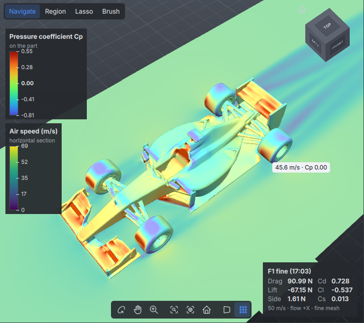
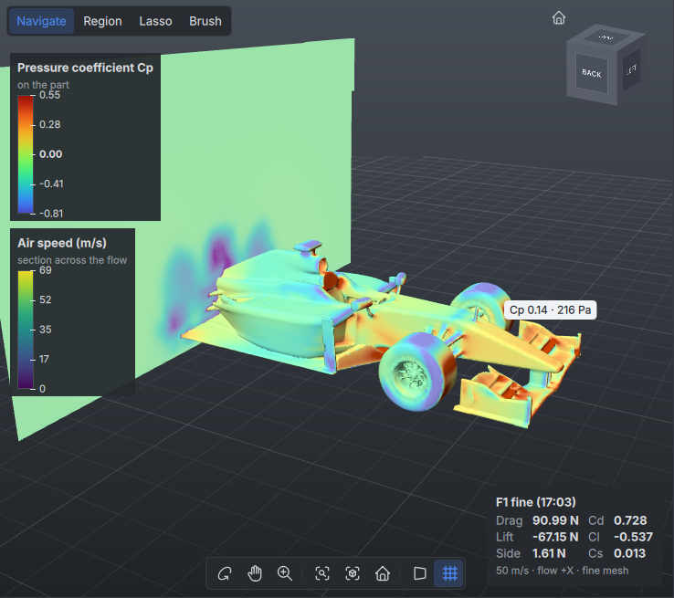
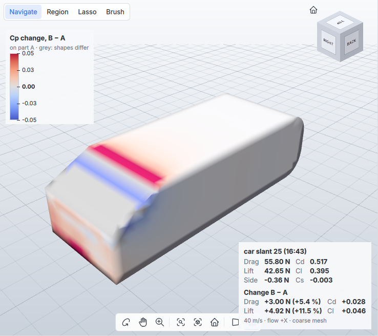
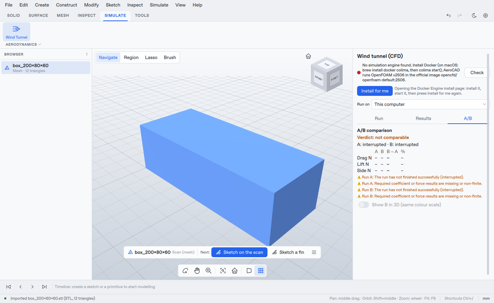

# Wind tunnel (CFD)

AeroCAD simulates the flow of air around a part with [OpenFOAM](https://www.openfoam.com)
in the background and shows how the part behaves: drag, lift and side force in newtons,
Cd/Cl over the iterations, surface pressure, velocity sections and streamlines. Two runs
can be compared (A/B).

Everything goes through the `simulation.*` commands, so the UI, scripts and an AI agent
(MCP tools `simulation_run`, `simulation_status`, `simulation_compare`, ...) use the same
code (module `src/cfd`, commands in `src/commands/src/SimulationCommands.cpp`).

## In the app

Toolbar **SIMULATE > Wind Tunnel** (or menu Simulate > Wind Tunnel) opens the wind tunnel
panel in place of Properties:

- **Run**: the engine status (green = ready), settings for a new run of the part
  selected in the browser (speed, flow direction, mesh, moving floor, other visible
  parts as surroundings, label) and **Run CFD**. With the moving floor on, *Floor at Z
  (mm)* says where the road is (`groundHeight`); empty puts it just below the parts. For a
  part mounted on a car give the road's height, as the gap changes the forces (200 mm box,
  flow +X, 30 m/s, coarse: floor 4 mm below Cd 0.855 / Cl +0.095, 40 mm below Cd 0.839 /
  Cl −0.070, 150 mm below Cd 0.824 / Cl 0.003, no floor Cd 0.817;
  [panel](images/audit/cad-147-floor-height.png)). A floor above the part is refused with
  both heights, shown under **Run CFD** before the run. The part's size is shown above the
  settings; a part under 20 mm or over 50 m gets a warning to check its units first (a
  model in metres read as millimetres is 1000 times too small). `simulation.propose_run`
  and `simulation.run` return the same text in `warnings`. A part whose mesh is not closed (a raw scan
  shell, a surface, holes) is warned about too, with the number of open edges: the mesher
  cannot tell inside from outside and wraps an open shell in a layer about one cell thick,
  so its forces depend on the mesh (measured on `dome_scan.stl`, 329 open edges: drag
  1.83 N open, 0.82 N after *Repair* filled the holes;
  [warning](images/audit/cad-145-open-part-warning.png)). Close it first with MESH > Scan
  Tools > Repair (*Fill holes up to* at least that many edges). Below, the runs of this design
  (newest first) with state, progress, Cd and drag; Cancel / delete (both asked first: deleting removes the run's files, a stopped run cannot
  be resumed; [confirmation](images/audit/cad-151-confirm-delete.png)); click a run to make it
  **A**, press **B** on another to compare. Runs whose part is not in the open design are
  folded under *Runs from other designs (N)* (a run of another design that is A or B stays
  shown); on first show A is the newest run of this design, never one of another design.
  While a new run is set up, the view shows the planned **wind tunnel** (dashed outline of
  the domain) and **arrows of the air** flowing onto the part, so a wrong flow direction is
  seen before the run; they follow the *Air flows* choice and the part.
  (`simulation.propose_run` returns them as `partModel`, `domainModel` and `flowModel` in
  model mm; `checkEngine: false` skips the slow engine check.)
- **Results**: progress while it runs, then drag/lift/side force in N, Cd/Cl/Cs,
  pressure vs friction drag, the conditions, the quality status and warnings, and charts
  of the coefficients, forces and residuals per iteration (updated live). **Show in 3D**:
  pressure on the part (Cp), horizontal and vertical velocity sections and streamlines
  (speed). Pressure is drawn in a high-contrast rainbow map (blue = suction, green = Cp 0,
  red = stagnation) or, under *Pressure colours*, blue-white-red; Cp 0 sits in the middle
  of the scale and each side of zero is scaled on its own. The Cp range is the 2nd to 98th
  percentile of the values (a few extreme points at the stagnation point or a sharp edge
  do not wash out the map); *Cp range* takes a typed min/max, *Auto* goes back. The
  pressure map is shaded and the streamlines are drawn as thin, see-through shaded tubes,
  so the shapes read in 3D; the sections stay flat and unlit so their colours match the
  legend exactly. Sections are cropped to the region around the part (0.4 part lengths
  ahead, beside and above, 1.5 lengths of wake), streamlines to 3 lengths of wake.
  Each run also writes stacks of sections (CAD-148): 15 planes across the flow (from 0.1
  part lengths ahead of the part to 1.5 lengths behind its front), 5 vertical planes along
  the flow and 6 horizontal ones, cropped to the same region (about 40 MB on a 2.3 M cell
  mesh). A slider under each ticked section steps through its planes, with the position
  in mm next to it; *Section across the flow* shows the wake behind the part and the
  wakes of wheels and wings. Runs made before the stacks have only the two sections
  through the part centre.
  Streamlines start from a 16 x 10 rake just ahead of the part, a little wider and taller
  than it, and from an 8 x 5 rake just behind it traced both ways, which shows the
  recirculation in the wake (runs made before this change have 35 lines from far
  upstream). Hovering over the pressure map shows Cp and the pressure in Pa at the
  pointer; over a section, the speed and Cp. The viewport shows a
  colour bar for each quantity (sections and streamlines share one speed scale) and a card
  with drag, lift and side force in N, Cd/Cl/Cs and the run conditions; the guide bar
  steps aside while results are shown. The part
  itself is hidden while its pressure map is shown. The 3D results are drawn only while
  the open design holds the run's part unchanged: deleting or changing the part hides
  them (undo brings them back). File > New and Open start with no run selected.
- **A/B**: verdict, drag/lift/side of A and B with the difference in N and %, differing
  conditions and notes; *Show B in 3D* shows B's fields on the same colour scales as A.
  *Difference B − A on the part (ΔCp)* (Results tab, Show in 3D) replaces A's pressure map
  with the change of pressure: red where B has higher pressure, blue where lower, on a
  blue–white–red scale symmetric about zero over the 2nd–98th percentile of the change.
  Points of A with no surface of B within 1 % of the part length (where the shapes differ)
  are grey. The forces card then adds the change of drag and lift in N and % and of Cd/Cl
  on A's reference area.







Runs continue when the panel or the app is closed.

While a run runs, Results does not judge it yet: the badge reads *checks: after the run*
(grey), and neither the quality warnings nor the reasons why final results are missing are
listed, since every check is still incomplete then
([running run](images/audit/cad-150-running-checks.png)). The live charts and provisional
values are shown as before.

Instead of dashes, the force and coefficient grid then shows the *current values*: the
mean over the last 20 % of the iterations recorded so far, the same averaging as the final
results, dimmed and headed "Current values (provisional)" (CAD-158,
[live fine run](images/audit/cad-158-current-values.png)). `simulation.results` returns
them as `current` only while the run is running; `summary` stays null until it finishes, and
A/B never uses them.

While a run runs, Results and the run list say how long it has run (`elapsedSeconds`, for
runs this app started) and, while solving, at most how long is left (`remainingSeconds`):
the solver's speed since the initialisation ended, applied to the iterations left before
the limit; it often stops sooner when it converges
([fine mesh of the 200 mm box on 4 cores](images/audit/cad-149-run-time.png): meshing
about 13 min, then "at most 1 h 55 min left").

Runs on this computer share its processors: a run starts at once while its solver processes
fit next to the runs already solving (up to the number of logical cores; each run uses half
of them by default, so A and B run side by side). Further runs wait in a queue (state
*running*, stage *queued*) and start by themselves, oldest first, when processors free up:
oversubscribed OpenFOAM runs are many times slower than the same runs one after the other
(measured on 4 cores: 4 coarse runs started together had none finished after 200 s; 3
runs through the queue all finished within about 95 s). A queued run can be cancelled; it does not survive closing the app (it is then
reported as stopped). Runs on a remote engine are not queued here.

## Engine: OpenFOAM v2506 in Docker

One OpenFOAM version is supported: **OpenFOAM v2506** (openfoam.com / OpenCFD). Cases
are generated for, and tested with, this release only.

The default engine is the official image `opencfd/openfoam-default:2506` from Docker
Hub. It is published for `linux/amd64` and `linux/arm64`, so it runs natively on Apple
Silicon (no emulation). Download size is about 380 MB (arm64) / 470 MB (amd64), 2.2 GB
unpacked; the first run pulls it automatically.

### macOS

Docker Desktop is not needed. The Docker engine needs a Linux VM on macOS;
[Colima](https://github.com/abiosoft/colima) (MIT, command line only) runs one, and the
`docker` command line tool from Homebrew talks to it.

**Install for me** in the CFD panel (command `simulation.install_engine`) does the next
step each time it is pressed, and then keeps checking until the engine is ready:

- Homebrew installed, docker or Colima missing: opens a Terminal window running
  `brew install docker colima && colima start --cpu <all cores> --memory <half of the RAM> --vm-type vz`
  (Apple's Virtualization framework; Colima's default, QEMU, is not installed by Homebrew's
  colima);
- docker and Colima installed, engine not running: opens a Terminal window running the same
  `colima start`;
- no Homebrew: starts Docker Desktop if it is already installed, otherwise opens
  [brew.sh](https://brew.sh) (install Homebrew, then press the button again);
- engine running, image missing: downloads `opencfd/openfoam-default:2506` with a progress
  bar.

Colima's default VM (2 CPUs, 2 GiB memory) is too small for the medium and fine meshes,
hence `--cpu` and `--memory`. After a restart of the Mac, press Install for me again (or
run `colima start`), or start Colima at login with `brew services start colima`.

By hand:

1. `brew install docker colima`
2. `colima start --cpu 8 --memory 8 --vm-type vz` (adapt to the machine)
3. Optional, to avoid waiting on the first run: `docker pull opencfd/openfoam-default:2506`.
4. In AeroCAD run `simulation.environment` (or open the CFD panel): it should report
   Docker running.

Runs are stored in `~/.aerocad/cfd/<run id>/` (override with `AEROCAD_CFD_DIR`). The
engine's VM must be able to mount that directory: Colima mounts the home directory writable
by default (and so does Docker Desktop), so a runs directory outside it will not work.

Docker Desktop and OrbStack work too (same `docker` CLI). OrbStack needs a paid licence
for commercial use ([OrbStack licensing](https://docs.orbstack.dev/licensing)).

The app finds `docker` in `PATH` and in the usual install locations
(`/usr/local/bin`, `/opt/homebrew/bin`, `~/.docker/bin`, `~/.orbstack/bin`, Docker.app),
because apps started from the Finder do not get the shell's `PATH`. `AEROCAD_DOCKER`
overrides the path.

### Another machine (remote engine)

To keep the computation off this computer, OpenFOAM can run in Docker on another machine
(Linux or macOS with Docker), reached over SSH. In the CFD panel choose **Run on: Another
machine (Docker over SSH)**, enter `ssh://user@host` (or `ssh://user@host:port`) and press
**Connect** (command `simulation.set_engine {remoteHost}`). The connection is tested first
(`docker -H ssh://user@host info`); the setting is saved only when Docker answers there, in
`~/.aerocad/cfd/engine.json` (`AEROCAD_ENGINE_HOST` overrides it). Choose *This computer* to
go back.

`scripts/setup-remote-engine.sh user@host [port]`, run on this computer, does all of the
setup below and saves the setting: it creates an SSH key if there is none and copies it to
the other machine (asks for that machine's password once), checks Docker there (adds
docker to the SSH PATH on macOS, starts Docker if it is stopped, adds the user to the
`docker` group on Linux with sudo), downloads the OpenFOAM image there and runs a short
OpenFOAM check through `docker -H ssh://user@host`. It can be run again.

Requirements:

- this computer: the `docker` command line tool only (macOS: `brew install docker`; Install
  for me does it), no engine;
- SSH login with a key, without a password prompt, and the host key accepted once (run
  `ssh user@host` in a terminal the first time);
- on the other machine: Docker running, the user allowed to run `docker` (Linux: in the
  `docker` group), and `docker` on the PATH of a non-interactive SSH login (macOS: Docker
  Desktop's or Homebrew's `docker` may be missing from it; check with
  `ssh user@host docker info`).

How it runs: the case is copied into a new container there (`docker create` + `docker cp`;
the two machines share no directory), the container runs `./Allrun` with all CPUs of that
machine (up to 16 processes), and every 10 s the progress files, logs and
`postProcessing/` are copied back, so the panel shows progress as usual. At the end the
results are copied back and the container is removed. The mesh and field files stay out of
the copy, so `case.foam` of a remote run does not open in ParaView. When the app is closed
the run continues there, and the app follows it again on the next start. Listing runs
(`simulation.list`, the panel refresh) only reads: a remote run that another open AeroCAD
window started is shown, but only that window follows it. Cancel removes
the container. Install for me downloads the OpenFOAM image on that machine.

### Linux

Docker Engine works the same way (the container runs as your user id). Alternatively a
local OpenFOAM v2506 installation is used when no Docker is running: the app sources
`$WM_PROJECT_DIR/etc/bashrc`, `/usr/lib/openfoam/openfoam2506/etc/bashrc` (the
openfoam.com packages) or the file named by `AEROCAD_OPENFOAM_BASHRC`.

Windows is not supported yet.

## Preset `external-flow-v1`

Steady, incompressible external flow around the selected part in a virtual wind
tunnel:

| Item | Choice |
|---|---|
| Solver | `simpleFoam` (SIMPLE, consistent), initialised with `potentialFoam` |
| Turbulence | RANS k-omega SST, wall functions |
| Mesh | `blockMesh` background (cubic cells) + `snappyHexMesh` on the part |
| Domain | 3 L upstream, 8 L downstream, 2.5 L to the sides, above and below (L = largest part dimension) |
| Boundaries | fixed velocity inlet, fixed pressure outlet, slip far field; optional floor, moving with the air (`groundMoving`, default) or fixed, just below the geometry or at `groundHeight` (mm, model Z) |
| Fluid | air: nu = 1.5e-5 m^2/s, rho = 1.205 kg/m^3 |
| Inflow turbulence | intensity 1 %, nu_t/nu = 10: k = 1.5 (U I)^2, omega = k / (nu * 10) |
| Stop | residuals p < 1e-4, U, k, omega < 1e-5, or the iteration limit |

Mesh levels (cells per L in the background mesh / surface refinement levels /
near box level / wake box level / prism layers): coarse 2 / 3-4 / 2 / 1 / 0,
medium 3 / 4-5 / 3 / 2 / 2, fine 4 / 6-7 / 4 / 3 / 3. The near box holds the part with
0.1 L around it, 0.15 L ahead and 0.75 L of wake; the wake box reaches 0.5 L around it
and 3 L behind. Each level halves the cell size: on the fine mesh of a 1.1 m car the
surface cells are 2.2 to 4.4 mm (CAD-153). Default iteration limits 300 / 500 / 800. Coarse is meant for
quick A/B checks. The preset is checked against the Ahmed body experiments in
[cfd-validation.md](cfd-validation.md).

**Units and axes.** The model is in millimetres, the case in metres (converted when the
case is written). The flow direction is one of `+X`, `-X`, `+Y`, `-Y` in model axes
(default `+Y`: the air hits the side you see in the Front view); Z is up. To set a part
up, use Move / Rotate / Scale (M): **Lay on Face** puts the face you click on the ground,
**Face Front** turns the face you click towards the oncoming air ([ui.md](ui.md#move--rotate--scale)). The case is
rotated so the air flows along its +X axis. Results are reported as **drag** (along the
flow), **lift** (+Z) and **side** force, and field data is converted back to model
coordinates.

**Reference values.** Aref defaults to the frontal area of the part (projection on the
plane normal to the flow, rasterised), lRef to its length along the flow. Both can be
set. Forces in N do not depend on them.

**Other parts in the flow** (`context`): e.g. the body section a part is mounted on.
They are walls in the simulation but not part of the reported forces. Sketches and
construction planes are drawing aids: they are never put into the flow, and cannot be the
simulated part either.

## Running

```json
{"name": "simulation.propose_run", "params": {"id": 1, "speed": 30}}
{"name": "simulation.run", "params": {"id": 1, "speed": 30, "label": "A"}}
{"name": "simulation.status", "params": {"run": "20261106-140102-rear-wing"}}
{"name": "simulation.results", "params": {"run": "20261106-140102-rear-wing"}}
```

`simulation.run` returns at once with a run id; the run continues in the background,
also when the app is closed (it is picked up again on the next start). Progress is
estimated from the current step (`aerocad.stage`) and the solver iteration. A run
records everything needed to repeat it: `case.json` (settings, frame, reference values,
geometry hash), `run.json` (source part, its revision and geometry fingerprint, engine command) and the complete
OpenFOAM case, which can be opened in ParaView through `case.foam`.

`Allrun` stops before `potentialFoam` and `simpleFoam` when `checkMesh` reports a defect
the solver cannot run on: zero or negative cell volume, incorrectly oriented faces (face
pyramids), zero or negative face area, open cells, or cells with invalid face labels. The
run then fails at step `check` with these reports in its message, and `log.checkMesh`
stays in the case. Other `checkMesh` reports (non-orthogonality, skewness, aspect ratio,
face tets) are warnings: the solve runs and the quality report flags them. The patterns are
the `***` reports of OpenFOAM v2506's `primitiveMeshCheck` (`kFatalMeshChecks` in
`Settings.hpp`). A failed solve shows the first line of an OpenFOAM fatal error, or for a
floating-point exception (a diverged solution) the iteration it reached, instead of the
last log line, which is often an MPI separator.

Runs are stored per user, not per project. `sourceInDocument` in the status tells whether
the open document still has the run's part (same id and same geometry).

`simulation.run` with `prepareOnly: true` only writes the case; run `./Allrun` in an
OpenFOAM v2506 environment elsewhere and register the result with `simulation.import`.
Imported cases require the same `aerocad.status = finished` completion marker as local
runs. Existing coefficient files alone do not establish successful completion.

## Results and checks

`simulation.results` returns a final summary (mean over the last 20 % of the iterations)
only after successful completion with complete, finite coefficient and force output
covering the same iterations. Otherwise all summary metrics are `null` and
`finalResults.available` is false, with explanations in `finalResults.reasons` and the
lifecycle state in `run.state`. Prepared, running, interrupted, cancelled and failed
runs cannot supply final results. Histories (Cd, Cl, Cs, forces) and residuals remain
available for monitoring; `provisional` marks data that is not final, also labelled in
the app's charts. Non-finite values anywhere in the required histories and unreplaced
truncated rows block final results, including before the averaging window. A repeated
or restarted iteration replaces the earlier data at and after that time; valid sparse
sampling is supported. Numerical quality is assessed separately in the quality report:

- volume mesh: `checkMesh` verdict and cell count,
- convergence: the final solver step must report SIMPLE convergence and a completed log,
- mass balance: last time-step continuity error (warning above 1e-3),
- residuals: all final initial residuals must meet the existing `external-flow-v1` targets:
  p below 1e-4 and Ux, Uy, Uz, k and omega below 1e-5,
- force history: at least 20 complete, finite Cd/Cl/Cs samples; band of Cd over the last
  20 % of the iterations (at least 10 samples; warning above 2 %).

The quality report's `checks` object records `passed`, `failed` or `missing` for each
required check. Status is `ok` only when every check passed, `warning` when any failed,
and otherwise `unknown` because evidence is missing. `warnings` explains failed and missing
checks in the results panel; the panel shows the residual warnings and the solver's "not converged"
line as one line with the final residuals, and says when Cd is steady (force stability passed),
so a usual coarse run reads as two lines instead of seven
([real coarse run of the 200 mm box](images/audit/cad-116-cfd-results.png)). Truncated histories, stale residuals/coefficients that do not
reach the final logged iteration, and non-finite data cannot receive a clean verdict.
Available raw diagnostics remain in the report even if another required check is missing.
These checks flag results to read with care; they are not a validation of the physics.
`tests/gui/cfd_quality_fixture.py` prepares synthetic missing/complete-evidence cases and
a mouse-driven `--ui-script` check of the Results panel. Its screenshots demonstrate reporting,
not a numerical solver run; see the script's usage for the local-only GUI check.
An inspected [missing-evidence example](images/audit/cad-82-quality-evidence.png) shows the
synthetic case's `unknown` verdict and the reasons displayed in the real Results panel.

`simulation.field` summarises the field outputs: `surface` (pressure on the part as
p, Cp and Pa), `sectionHorizontal` / `sectionVertical` (planes through the part centre,
speed in m/s and Cp), a plane of a section stack (`sectionX_<i>` across the flow,
`sectionY_<i>` vertical along it, `sectionZ_<i>` horizontal; `simulation.results` lists
the run's planes in `fields.sections` with their fraction of the part and position in mm)
and `streamlines` (a rake ahead of the part and one in the wake).
Each scalar has `min`, `max`, `mean` and the 2nd/98th percentiles `p02`/`p98`, which the
app uses for the pressure colour range.

## A/B comparison

`simulation.compare {a, b}` returns the force differences in N and %, the coefficients
of B rescaled to A's reference area, the list of differing conditions (speed, direction,
mesh, preset, fluid, ground, reference values), the quality of both runs and shared
colour scale ranges (Cp on the surface, speed in the sections). Verdict:
`comparable`, `difference inconclusive`, `check quality` or `not comparable`. Variants of very different size get
different domain and mesh sizes, which is reported as a note.

The resolved setup is compared too, not only the requested settings. Each case records a
fingerprint of its surroundings (context parts in model coordinates, independent of their
order); `Allrun` records the engine that actually runs the solver (`WM_PROJECT_VERSION`, in
`aerocad.engine`). OpenFOAM skips an application whose log already exists, so a rerun that
reuses `log.simpleFoam` keeps the engine recorded with those results (or none). `results.conditions` carries `domain`, `contextHash`, `engine` (null when
not recorded) and `engineTarget` (the version the case was written for). Different surroundings (for example the part alone against the same part next to
the car body) add `context` to `differingConditions`, a different engine adds `engine`;
either makes the verdict `not comparable`. A flow domain that differs by more than 1 µm adds
`domain` and sets `sameDomain` to false. The target part itself may differ, since that is the
A/B: when the domain is the only difference, the forces are still compared, a note gives the
difference in mm and the verdict is `different domains` instead of `comparable`. What an
older run did not record (surroundings, domain or engine) is listed in `unknownConditions`
and makes the verdict `not comparable`.

Both runs must have final results. Otherwise the verdict is `not comparable`, force
and coefficient differences and shared colour scales are empty, and `states` / `reasons`
explain which run is unfinished or has incomplete output. Partial histories remain in
`simulation.results`; they are never used for a final A/B or mesh-sensitivity verdict.
Field visualisations are optional: a valid force comparison does not require VTK maps.

**Mesh check.** A difference found on one mesh can be an artefact of that mesh.
`simulation.refine {run, mesh}` runs the same case (same part, surroundings and conditions)
on another mesh level; run it for A and for B (in the app: *Run A and B on the medium
mesh* in the A/B tab). `meshSensitivity` in `simulation.compare` then lists the
difference per mesh level and, for the two finest levels, how much refinement changed
it. The difference **holds** when it changed by less than half of itself and kept its
sign; otherwise it is **inconclusive** and the verdict becomes `difference
inconclusive`. Drag and lift are both checked; the verdict follows the one with the
larger difference, and the message also names the other force when its difference does
not hold. When a run on one of those two levels has quality warnings the status is
**check quality** (verdict `check quality`). `simulation.refine` refuses a run whose part or
other parts in the flow have changed since it ran. Runs count as the same case when the geometry hash and all
conditions except the mesh level are equal. When A and B themselves are the same case (a
repeat run), their difference is run-to-run variation and the status is **same case**:
there is nothing to check on another mesh. While runs of the check are still solving the
status is **pending** and `runningRuns` lists them; the A/B tab shows their progress.

### Pressure difference on the part

`simulation.field {run: A, kind: "surface", compare: B}` interpolates B's surface values
onto A's surface points (`cfd::surfaceDifference`: nearest point of B within 1 % of the
part length, found on a uniform grid) and returns A's surface with scalars `dCp`, `dp` and
`dpressure` (B − A; NaN where B has no point near enough). The viewport draws NaN grey.

## Tests

`ctest -L openfoam` runs a box through the whole pipeline in OpenFOAM (about a minute
with Docker; skipped when no engine is found). On macOS its case goes under `~/.aerocad/test-runs/`,
because the engine's VM shares only the home directory, not `$TMPDIR`. It is not part of the CI gate. `app_cfd_difference_3d_test` (labels gui, openfoam) runs the
box twice at once and checks the difference map, its colour bar and the card in the real
GUI; two parallel runs of the same shape differ by about 0.004 to 0.011 in Cp on 96 % of the part
(the test allows 0.03). The unit
tests (`test_cfd`, `test_commands`) cover case generation, parsing, quality checks, the
run manager and the commands without an engine.

`tests/gui/cfd_provisional_fixture.py` generates synthetic partial/finished outputs and
real-GUI scripts for the final-result gate. It checks provisional charts, blocked A/B
values, light/dark presentation and independent colour scales for an incomplete pair.
Its optional cancellation script starts and cancels a real sleeping child process with
synthetic output; it does not run or validate OpenFOAM. The script's usage examples show
how to reproduce both checks.


