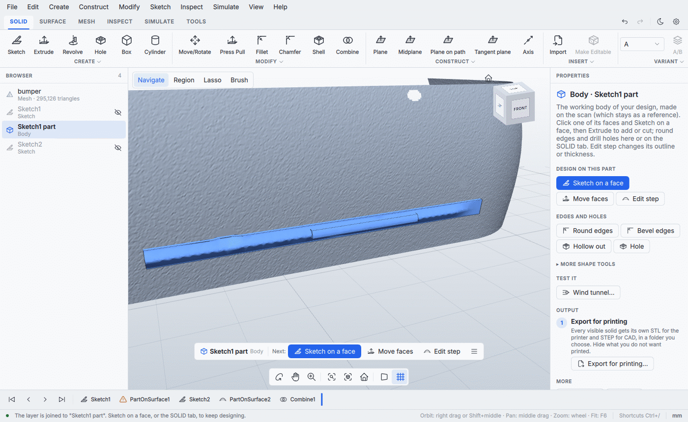

# AeroCAD

AeroCAD is a desktop CAD application for designing **aerodynamic parts on top of a 3D scan** of a
car: a splitter lip, a canard, a diffuser strake, a wing end plate. You load the scan, draw the
outline of the part on the scan's curved surface, and AeroCAD turns it into an editable solid that
follows the scan exactly. You shape it, test it in a built-in wind tunnel (OpenFOAM) and export it
for 3D printing or CNC.

## The golden path

This is the one route through the program that has to work, and the route this documentation
teaches step by step:

| | Step | Where it is taught |
|---|---|---|
| 1 | **Load** a scan of a bumper or of the whole car (STL, OBJ, PLY, 3MF, STEP) | [Load the scan](manual/step-1-scan.md) |
| 2 | **Draw the outline** of the part on the scan | [Draw the outline](manual/step-2-outline.md) |
| 3 | **Create the part**: it becomes an editable solid body, the centre of your design | [Create the part](manual/step-3-part.md) |
| 4 | **Sketch on the curved face** of the part and **extrude along the surface** | [Sketch on the curved face](manual/step-4-sketch.md) |
| 5 | **Shape it** like an aero part: ridge, lip, fade-out, taper | [Shape it](manual/step-5-shape.md) |
| 6 | **Test it** in the wind tunnel (CFD, local Docker) | [Wind tunnel](manual/step-6-cfd.md) |
| 7 | **Export** for printing (STL) or CAD (STEP) and **save** the project | [Export and save](manual/step-7-export.md) |

Start with the [overview of the path](manual/golden-path.md), or go straight to
[Install and run](manual/install.md) if you have not built the program yet.

## Examples

- [Front splitter lip on a bumper](manual/example-lip.md): the whole path with concrete numbers.
- [Canards on a bumper corner](manual/example-canards.md): fins that stand out of the surface.
- [Compare two designs (A/B)](manual/example-ab.md): two variants, two wind tunnel runs, one answer.

## Good to know before you start

- **Always read the status bar** (bottom of the window). It reports the result of every operation,
  for example how far a fitted surface is from the scan.
- **Everything can be undone** with ++ctrl+z++ (++cmd+z++ on a Mac), and nothing you do changes the
  scan itself.
- **Every length is in millimetres** in the input fields.
- **The Properties panel guides you.** Select a part and the top of the panel lists what it is and
  the next step, with buttons. If you are lost, select the part and read it.
- **The program is hardware-agnostic**: it works on any scan, not only on one scanner's output.
  Real scans are never flat and never perfect; the tools are built for that.

This site describes the program as it is on the `main` branch. The pages under *Reference* and
*Developers* are the technical documentation the program is built from.
