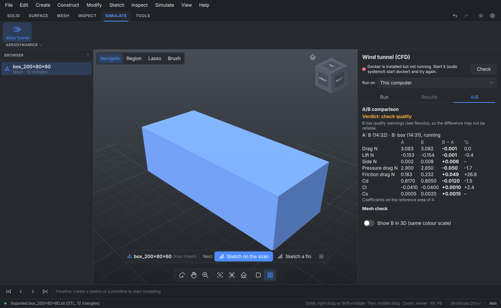
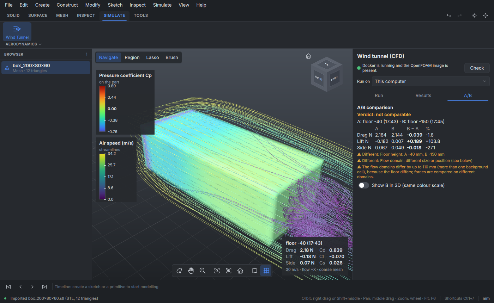

# Example: compare two designs (A/B)

Two designs, one question: *which one has less drag, or more downforce?* The wind tunnel compares two
runs under identical conditions and says whether the difference is real.

## 1. Make variant B

1. Finish design **A** (for example the lip of [the lip example](example-lip.md)).
2. Click **VARIANT > New** (or **Modify > Duplicate as New Variant**). The design is copied as
   **variant B** and becomes the active one. The drop-down at **VARIANT** shows which is active, and
   the **A/B** button switches between them; the camera stays where it is, so you see the difference.
3. Change B, for example **Edit step** on the part and set **Thickness** to 8, or change the **Ridge
   height**.

The imported scan is shared by both variants; only the timeline (features and parameters) differs.

## 2. Run both

1. In variant **A**, select the part, open the wind tunnel panel, set the speed, direction and mesh,
   and click **Run CFD**. Wait for the run to finish.
2. Switch to **B** (**A/B**), select its part and open the panel again. Select run A in the run list and click
   **Use the settings of A**, so that speed, direction, mesh, floor and surroundings are identical to the first run. Click
   **Run CFD**.

Use the **same mesh** (coarse is fine for a first comparison) and the same *Other visible parts in
the flow* setting in both. Different surroundings or floors make the verdict *not comparable*.

## 3. Compare

1. In the run list click run 1 to make it **A**. On run 2 click **Compare with A**.
2. Open the **A/B** tab. The verdict is one of **comparable**, **difference inconclusive**, **check
   quality** or **not comparable**, and the table lists drag, lift and side force of A and B, the
   difference **B − A** in N and in %, and Cd, Cl and Cs for B on A's reference area.

    

3. A difference smaller than the swing of the two runs is shown as "noise", with a note. Do not
   trust it.
4. **Mesh check**: *Run A and B on the medium mesh* runs the same two cases on a finer mesh. The
   difference **holds** when it keeps its sign and changes by less than half of itself.
5. **Difference B − A on the part (ΔCp)** (Results tab, *Show in 3D*) colours the part by the change
   of pressure: red where B has higher pressure, blue where lower, grey where the shapes differ.
6. **Swap A ↔ B** makes B the baseline. **Export CSV…** writes the table.

!!! warning "Compare like with like"
    Change one thing at a time. If speed, direction, mesh, floor or surroundings differ, the A/B tab
    lists them under the table and may mark the verdict *not comparable*.
