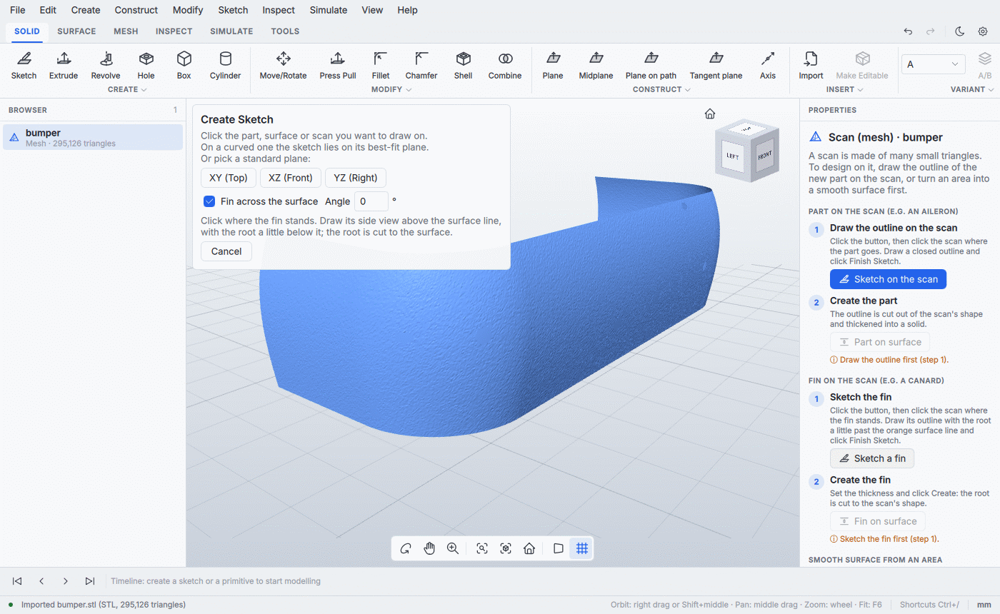
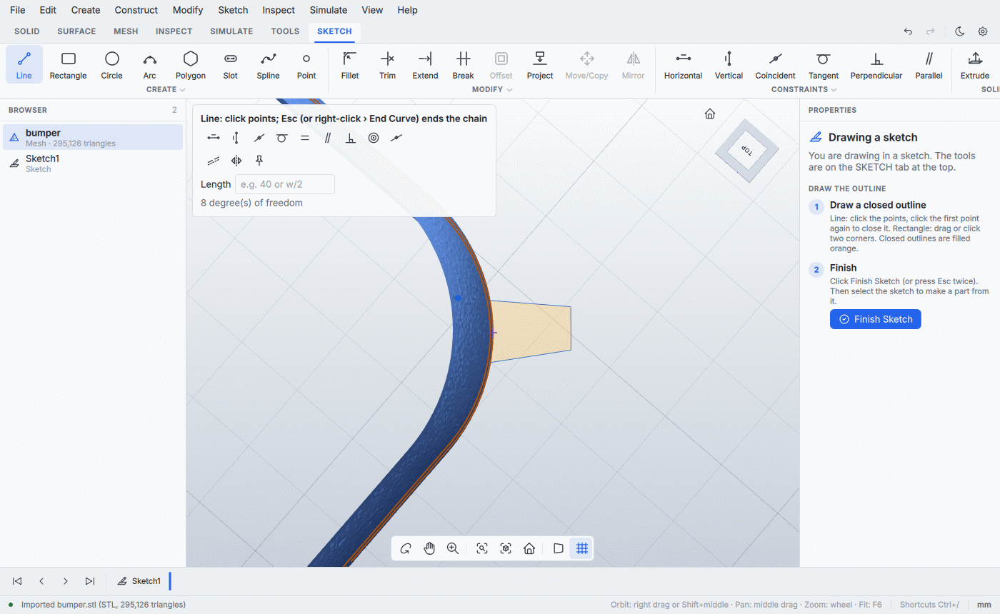
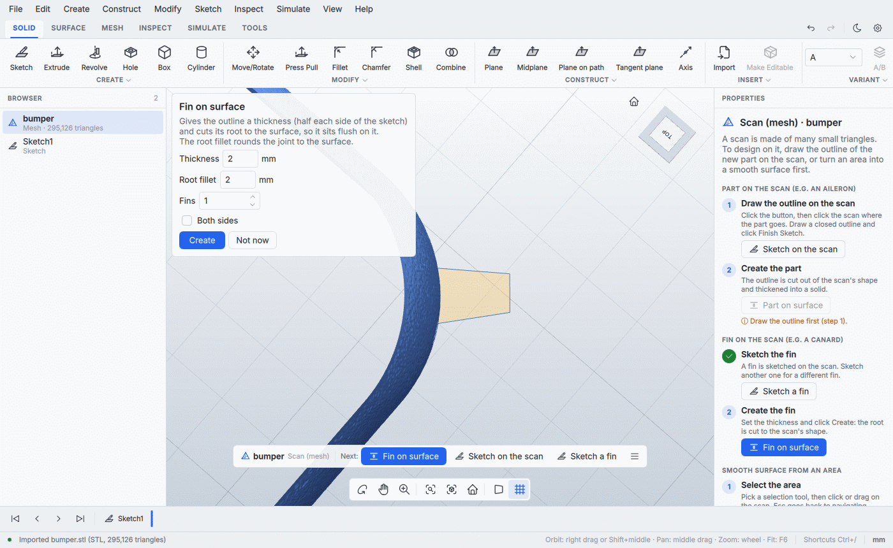
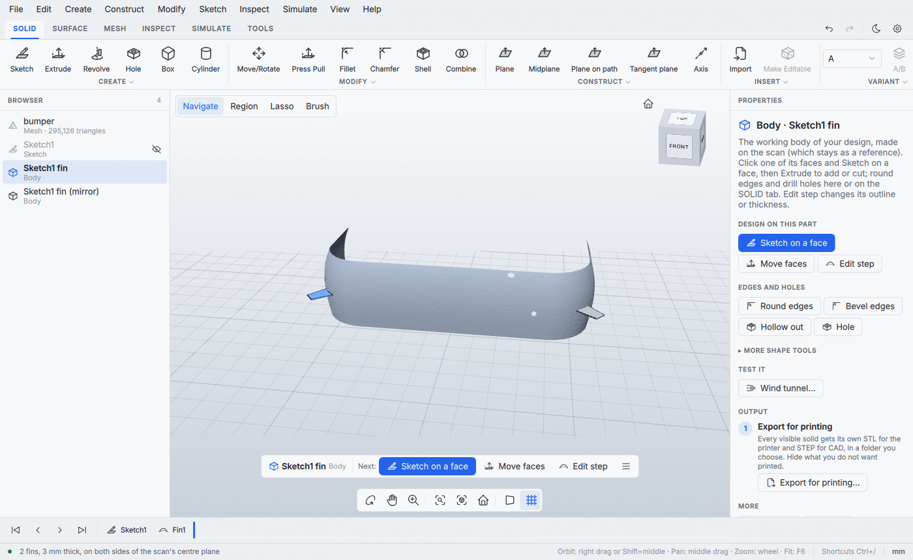

# Example: canards on a bumper corner

A **fin** is a part that stands *across* the surface (a canard, a strake, an end plate), not lying
on it. It has its own tools: **Sketch a fin** and **Fin on surface**.

## Steps

1. Select the scan and click **Sketch a fin** in its guide (*Fin on the scan*). The **Create Sketch**
   panel opens; it shows the checkbox **Fin across the surface** and an **Angle**.

    

2. Click the scan where the fin stands, on the bumper's corner. The sketch plane is **across** the
   surface (it stands on it). The orange line in the view is **the surface line**: where the plane
   meets the scan.
3. Draw the outline of the fin. Start **a little inside the scan**, past the orange surface line (this
   is the root), and draw the shape of the fin outwards. Use **Line** (++l++): click four points and
   click the first one again to close.

    

4. Click **Finish Sketch**. The panel **Fin on surface** opens:

    

    | Field | Meaning |
    |---|---|
    | **Thickness** | The fin's thickness; it is centred on the sketch plane (half on each side). |
    | **Root fillet** | Rounds the joint with the surface. |
    | **Fins** | A number of fins in a row; a **Spacing** field appears for more than one. |
    | **Both sides** | Also makes the mirror copy on the other side of the scan's centre plane. |

5. Set **Thickness** `3`, tick **Both sides**, click **Create**.

The status bar says *2 fins, 3 mm thick, on both sides of the scan's centre plane*. The Browser lists
`Sketch1 fin` and `Sketch1 fin (mirror)` as bodies; the timeline has `Fin1`. The root of each fin
is cut to the scan's shape, so it sits flush on the bumper.

## Notes

- Edit the fin later with **Edit step** (thickness, root fillet, count).
- Test the fins like any part: select one and click **Wind tunnel…**; tick *Other visible parts in
  the flow* to put the bumper around them.
- A fin outline that crosses the mirror plane, or runs into the mirror copy of another fin, is refused
  because the bodies would overlap.
- A fillet that would leave unmeshable slivers (a fin edge running into the scan at a shallow angle)
  is refused instead of giving an open STL. Lower the root fillet or change the outline.
- In the wind tunnel, **Export for printing** gives one STL per fin.
