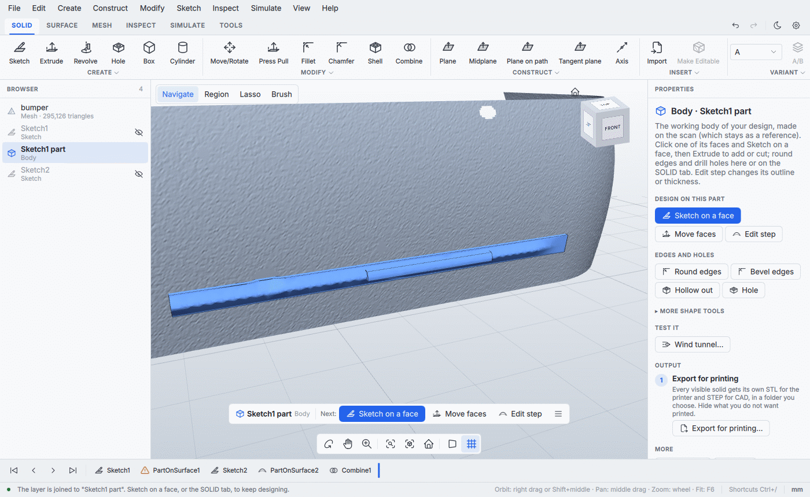

# Example: a front splitter lip on a bumper

The whole [golden path](golden-path.md) in one table, with the exact values used in the screenshots.
Use it as a checklist when you do the path on your own scan. Replace the sizes with the ones that
fit your car.

**Scan:** the test bumper, 1 200 × 450 × 300 mm, 295 126 triangles (millimetres, nose towards -Y).

| # | Do | Values | You should see |
|---|---|---|---|
| 1 | Import the scan | `bumper.stl` | `Mesh · 295,126 triangles`; size about 1200 × 450 × 300 mm |
| 2 | Select the scan, **Sketch on the scan**, click the lower front | click about 70 mm above the lower edge | SKETCH tab, the view faces the place |
| 3 | ++r++ (Rectangle), click a corner, type | `600, 30`, ++enter++ | a closed rectangle on the scan |
| 4 | **Finish Sketch** | | `Sketch1`; panel **Part on surface** |
| 5 | **Thickness** and **Direction** | `6`, **Outward** | |
| 6 | **Create** | | `Sketch1 part` (Body) selected; timeline `PartOnSurface1` |
| 7 | **Edit step**, tick **Shape the top** | **Ridge height** `8`, **Fade out** `80` | arrows in the view; **OK** rebuilds |
| 8 | **Sketch on a face**, click the part | | status: *Sketch1 part is curved here...* |
| 9 | ++r++, click a corner inside the part, type | `200, 12`, ++enter++ | |
| 10 | **Finish Sketch**, **Extrude along surface** | **Thickness** `5`, **Out of the surface**, **Joins the part** | status: *The layer is joined to "Sketch1 part"*; timeline ends `Sketch2`, `PartOnSurface2`, `Combine1` |
| 11 | **Wind tunnel…** | **Speed** `20`, **Air flows** `+Y (onto the front)`, **Mesh** *Coarse (fast)*; tick *Other visible parts in the flow* to include the scan | arrows hit the front of the lip |
| 12 | **Run CFD** | | run in the run list; results after it finishes |
| 13 | **File > Export for Printing...** | a folder | **Check before export**, then `Sketch1 part.stl` and `.step` |
| 14 | **File > Save** | `lip.aerocad` | |

## What the result looks like

The part after steps 1 to 10 (the lip with its ridge, and the rib on top of it):

## Variations to try

- Change the **Thickness** of `PartOnSurface1` to 4 and to 8 (**Edit step**) and compare the runs.
- Make the lip longer or shorter: double-click `Sketch1` in the timeline and change the rectangle's
  width with **Sketch Dimension** (++d++).
- Replace **Ridge height** by **End thickness** to make a wedge.
- **Round edges** on the lip's front edge (++f++), radius 1 to 2 mm, for a part that is nicer to
  print and handle.

## What is different with a real scan

The test bumper is generated: it has a double layer 3 mm behind the outer skin, noise of 0.15 mm,
holes and some flipped triangles, to behave like a bad real scan. That is why the example shows
the *Approximation* warning at step 6 and thin walls in the export check at step 13. On a clean scan
you may see neither. Read [Troubleshooting](troubleshooting.md) when you do.
