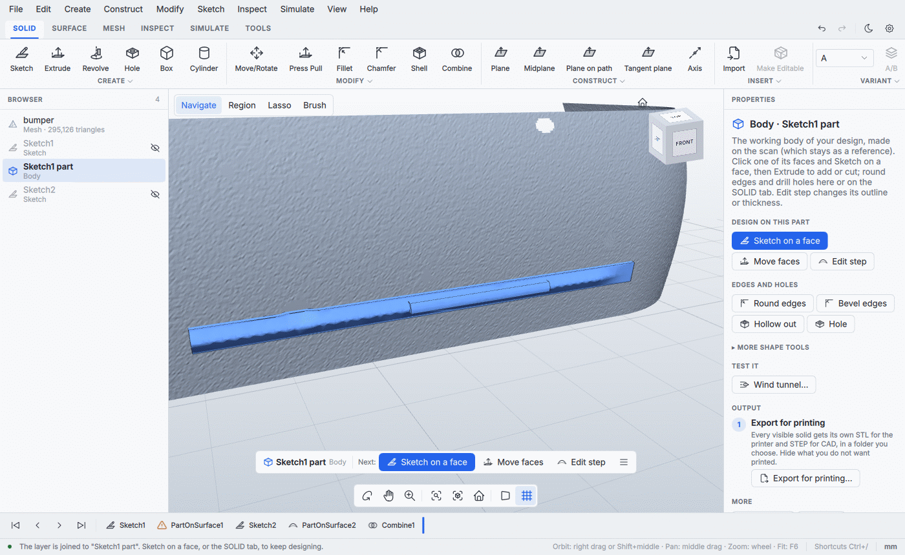

# The golden path: overview

This tutorial takes one real task from start to finish: **design an aero part on a scan of a car
bumper, test it, and export it for printing.** Every step says what to click, what you should see,
and what to do if you do not.

You can follow it with any scan of a car or a bumper. The screenshots use a generated test bumper
(a 1.2 m wide, noisy, slightly curved scan with holes and stray triangles, 295 000 triangles,
nose towards the viewer) because a real scan is never clean either. The example part is a
**front splitter lip**: a 600 × 30 mm strip along the lower edge of the bumper with a ridge, and a
small rib on top of it.

## The seven steps

| Step | What you do | You get |
|---|---|---|
| [1. Load the scan](step-1-scan.md) | Import the file, check its size and units | A scan part in the Browser |
| [2. Draw the outline](step-2-outline.md) | Sketch a closed outline on the scan, where the part goes | A sketch lying on the curved surface |
| [3. Create the part](step-3-part.md) | One click: *Part on surface* | An editable solid body that follows the scan |
| [4. Sketch on the curved face](step-4-sketch.md) | Sketch on the part's face, *Extrude along surface* | A rib, an emboss or a cut-out that follows the curvature |
| [5. Shape it](step-5-shape.md) | *Edit step*: ridge, fade-out, taper | An aero profile instead of a flat plate |
| [6. Wind tunnel](step-6-cfd.md) | Run OpenFOAM on the part | Drag, lift, pressure map, streamlines |
| [7. Export and save](step-7-export.md) | Export check, *Export for printing*, save | STL and STEP files, a `.aerocad` project |

## How the program thinks (read this once)

**The scan is a reference, never edited.** A scan is a mesh: hundreds of thousands of small
triangles. You cannot cut or thicken a mesh cleanly, so AeroCAD fits a smooth, exact CAD surface
(NURBS) to the scan *under your outline* and builds the part from that surface. The scan itself is
never changed. If you delete everything you made, the scan is as you loaded it.

**The part is a body, and it is the centre of your design.** After step 3 you have a normal
CAD body in the timeline. From now on you design *on the part*: sketch on its faces, extrude, round
edges, drill holes, combine. The scan stays behind it as a reference.

**Everything is a step in the timeline.** The strip at the bottom of the window lists every
operation (`Sketch1`, `PartOnSurface1`, `Sketch2`, ...). Double-click a step or use **Edit step** to
change its numbers later. Later steps rebuild by themselves.

**The Properties panel tells you what to do.** Select a part (in the view or in the Browser) and the
top of the panel on the right shows what it is, the next steps as numbered buttons, and, under a
disabled button, why it is disabled. The bar above the navigation buttons (*Next:*) repeats the
recommended next step. If you do not know what comes next, select the part and read the panel.

**Read the status bar.** The line at the very bottom reports the result of each operation, including
warnings.

## Before you start

- A built, running AeroCAD: [Install and run](install.md).
- A scan file. STL, OBJ, PLY, 3MF, STEP, IGES and BREP open. A bumper or whole-car scan of a few
  hundred thousand to a few million triangles is fine.
- For step 6 only: Docker and the OpenFOAM image (the program can install them for you).
- About 30 minutes for the whole path the first time.

Continue with [1. Load the scan](step-1-scan.md).
