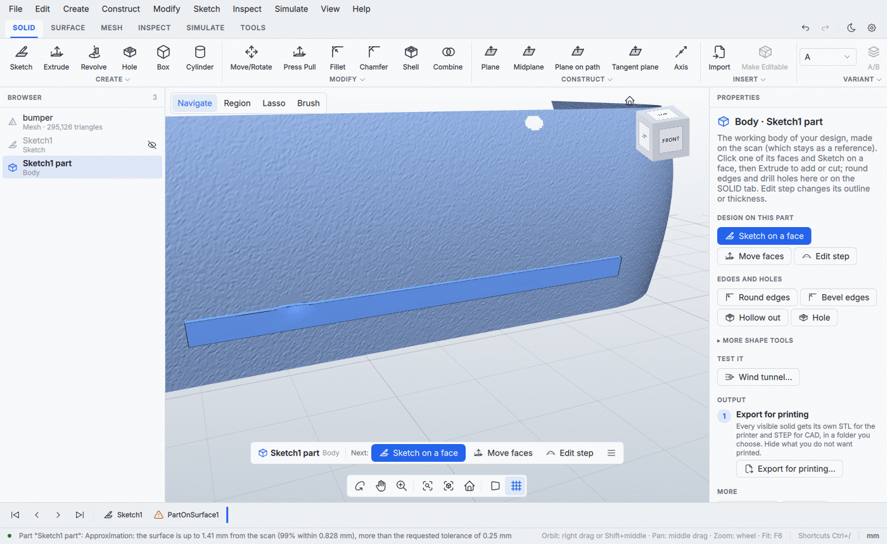

# The window and navigation

| Area | Where | What it does |
|---|---|---|
| **Menu bar** | top | File, Edit, Create, Construct, Modify, Sketch, Inspect, Simulate, View, Help. Every toolbar command is also here. |
| **Toolbar** | under the menu | One tab per kind of work: **SOLID** (sketch, extrude, fillet, combine, export), **SURFACE** (fit, cut out, part on surface, fin), **MESH** (scans: scan tools, selection, repair), **INSPECT** (measure, section, deviation and thickness maps), **SIMULATE** (wind tunnel), **TOOLS** (AI agent, parameters, shortcuts, preferences). The **SKETCH** tab appears while you edit a sketch. Undo/redo, the dark/light switch and Preferences are at the right end. |
| **Browser** | left | All parts: scans, sketches, bodies. Click to select, the eye icon shows or hides. Under each name is the type (*Mesh · N triangles*, *Body*, *Sketch*). |
| **3D view** | centre | The model. Top left: the selection tools (**Navigate**, **Region**, **Lasso**, **Brush**) and the dialog of the current tool. Top right: the **ViewCube**. Bottom: the **context bar** (*Next:* the recommended step) and the navigation bar. |
| **Properties** | right | The **guide** for the selected part (what it is, the numbered next steps), then name, size and physical properties. While you use the wind tunnel it is replaced by that panel. |
| **Timeline** | bottom | Every feature in order. Double-click to edit; right-click for Rename, Suppress, Roll Back To Here, Delete. A red step failed; hover for the reason. |
| **Status bar** | very bottom | The result of the last operation, mouse hints, the shortcuts link (++ctrl+slash++) and the display unit. |

**View > Reset to Default Layout** (++ctrl+alt+r++) restores hidden panels.

## Moving around

| Action | Mouse | Touchpad / Magic Mouse |
|---|---|---|
| Orbit | Right drag, or ++shift++ + middle drag | ++shift++ + two-finger swipe |
| Pan | Middle drag, or ++shift++ + right drag | ++ctrl++ (⌘) + two-finger swipe |
| Zoom | Wheel (towards the pointer) | Two-finger swipe up/down, or pinch |
| Select | Left click | Click |
| Context menu | Right click without moving | Two-finger click |
| Zoom to a part | Double click on it | Double click on it |
| Fit all | ++f6++, or double click on empty space | the same |

The **left button only selects**. If your mouse has no middle button, click **Orbit**, **Pan** or
**Zoom** in the navigation bar at the bottom of the view, and the left button does that until you
click the tool again. Mouse schemes of SolidWorks and Blender are in **Edit > Preferences > Mouse**.

**ViewCube** (top right): click a face (FRONT, TOP, RIGHT, ...) to look straight at it; click an edge
or a corner for an in-between view; drag it to rotate; the house icon returns to the home view.
The model is **Z-up**: Top looks down the Z axis, Front looks along +Y.

## Selecting things

- Click a part in the view or in the Browser.
- **Region** (++1++), **Lasso** (++2++) and **Brush** (++3++) select *triangles of a scan* (for surface
  fits); ++esc++ goes back to Navigate.
- Dialogs of CAD tools (Fillet, Extrude, ...) ask you to pick edges, faces or profiles in the view
  while they are open.

## Units and preferences

All input fields take **millimetres**. **Edit > Preferences** (⌘, on a Mac) changes the *displayed* unit
(mm, cm, m, in), the theme (system, light, dark), the mouse scheme and the autosave interval.

## Commands, search and scripts

- ++s++ opens a search box for commands.
- Every button runs a named command, and the same commands run from a script
  (`AeroCAD --run script.json`) or from an AI agent over MCP: see [AI agent access](../mcp.md) and the
  [CAD reference](../cad.md).
