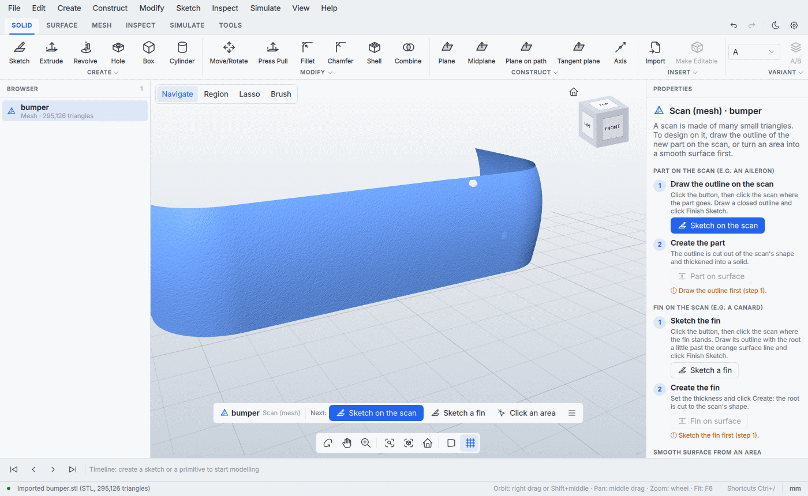
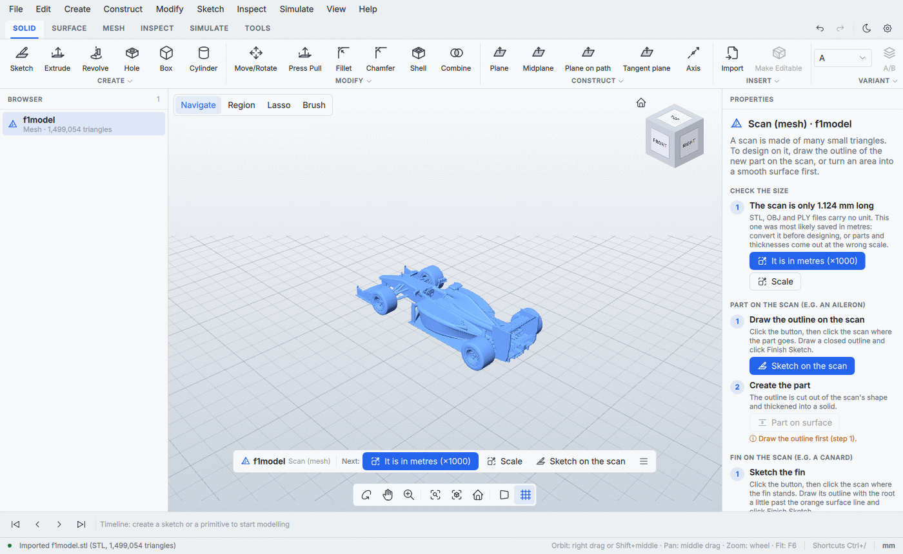

# 1. Load the scan

**Goal:** the scan is in the program, in millimetres, the right way up, and you can see all of it.

## Import

Use any of these:

- toolbar **SOLID > INSERT > Import**,
- menu **File > Import...**,
- drag the file onto the 3D view,
- start the program with the file: `AeroCAD bumper.stl`.

Supported files: STL, OBJ, PLY, 3MF, STEP/STP, IGES/IGS, BREP. Big scans load on a background thread
with a progress bar and a **Cancel** button.

The scan appears in the **Browser** (left) as `bumper`, with `Mesh · 295,126 triangles` under its name,
and is selected. The status bar says `Imported bumper.stl (STL, 295,126 triangles)`. Press ++f6++
(fit all) if you cannot see it.

The panel on the right is the **guide** for the selected part. For a scan it offers three routes:
*Part on the scan* (what this tutorial uses), *Fin on the scan* (see [Canards](example-canards.md))
and *Smooth surface from an area* (select an area, then fit a surface: advanced).

## Check the size (units)

STL, OBJ and PLY files carry **no unit**. AeroCAD reads them as millimetres. A scan saved in metres
would be 1000 times too small, and every thickness you type later would be wrong.

If the scan is shorter than 20 mm or longer than 50 m, the guide starts with **Check the size** and
names the unit the file was most likely saved in. A whole-car model saved in metres looks like this:

Click **It is in metres (×1000)**. The scan is scaled and the step disappears. If the guide offers
no such button, use **Scale** (Properties) or **MESH > Scan Tools > This part is in**. You can also
set **Unitless files in** (MESH > Scan Tools) *before* importing; the choice is remembered.

STEP, IGES and 3MF files carry their own unit and are converted automatically.

!!! tip "Verify the size"
    Select the scan: Properties shows **Size X / Y / Z**. A front bumper is about 1 200 × 450 × 300 mm
    (the test bumper has exactly that). A whole car is about 4 000 to 5 000 mm long.

## Orientation

The wind tunnel and the standard views assume **Z is up**. The front view looks along +Y; the
default wind tunnel direction is **+Y (onto the front)**, which fits a model whose nose points to -Y.
If your scan lies on its side or faces another way:

- select it and press ++m++ (Move / Rotate / Scale), then use **Lay on Face** (click a face that
  should be on the ground) or **Face Front** (click a face that should look to the front), or type
  an angle; or
- use **MESH > Scan Tools > Orient** (pick points on a flat area, choose XY / XZ / YZ, Align).

You can also leave the model as it is and choose the matching air direction in step 6 (the arrows in
the view show it).

## Clean-up (only if needed)

Scans have holes and flipped triangles. The tools are in **MESH > Scan Tools**: *Repair* (merges
vertices, fixes orientation, fills small holes) and the statistics of open boundaries. You do not
need to repair a scan to design a part on it; repair matters when the *scan itself* goes into the
wind tunnel as surroundings (step 6).

## Check

- [x] The scan is selected and fills the view after ++f6++.
- [x] Properties shows a plausible size in millimetres.
- [x] The guide's *Check the size* step is gone.

Next: [2. Draw the outline](step-2-outline.md).
