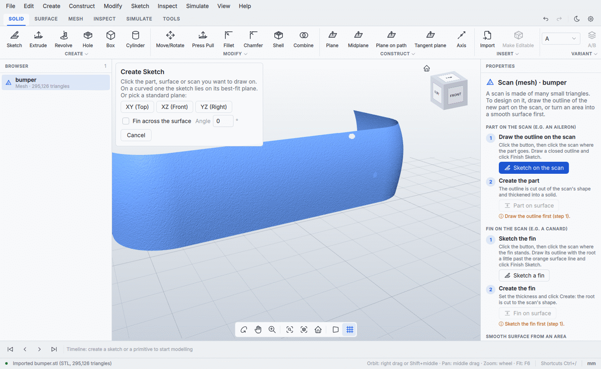
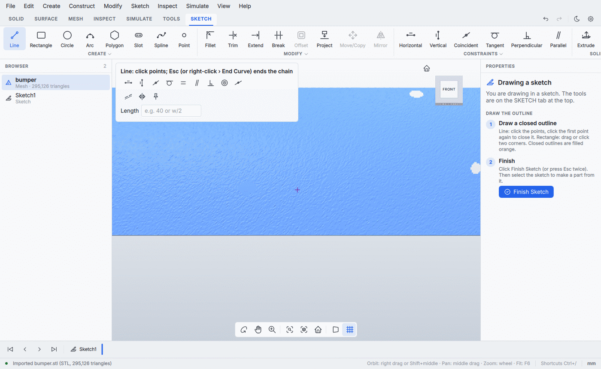
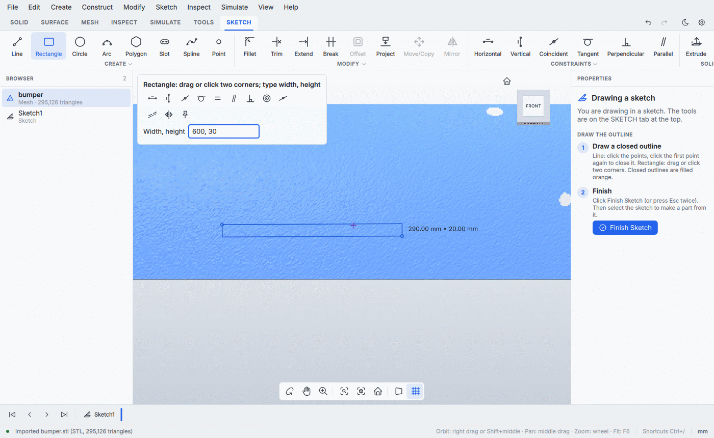

# 2. Draw the outline on the scan

**Goal:** a closed outline (a sketch) lying on the scan where the part will go.

You do not need to fit a surface first. AeroCAD fits one under your outline in step 3.

## Steps

1. **Select the scan** (click it in the Browser or in the view).
2. Click **Sketch on the scan** in the guide (or in the *Next:* bar, or **SOLID > Sketch**).
   A small panel **Create Sketch** opens at the top left of the view:

    

3. **Click the scan** where the part goes. For the example, click on the lower front of the bumper.
   The **SKETCH** tab opens, the view turns to look straight at the place you clicked, and the
   sketch plane is the best-fit plane of the scan there. The outline you draw is shown *lying on the
   curved surface*, not floating above it: clicks, previews and snapping follow the surface under the
   pointer.

    

4. Choose the **Rectangle** tool (press ++r++ with the pointer in the view). Click the first corner,
   move the pointer to the right and slightly up, and **type the size**: `600, 30` (width, height in
   millimetres), then press ++enter++.

    

    You can also drag or click two corners. For a free shape use **Line** (++l++): click the points
    and click the first point again to close it. **Spline**, **Arc**, **Circle**, **Slot** and
    **Polygon** are on the same tab. While a tool is active, a field in the panel shows what you can
    type (for a line its length).

5. Click **Finish Sketch** (right panel or the toolbar), or press ++esc++ twice.

You now have `Sketch1` in the Browser and the timeline, and the **Part on surface** panel opens
(step 3).

## Rules for a good outline

- **Closed.** An open outline cannot become a part. Closed outlines are filled.
- **Inside the scan.** If the outline runs past the edge of the scan, the status bar warns you. Keep
  it on the scan.
- **Smooth edges.** Fewer, smoother curves give a cleaner part edge than many short segments.
- **One part per sketch.** Draw another sketch for another part.
- **Exact sizes.** Type numbers while drawing, or use **Sketch Dimension** (++d++) afterwards. Values
  accept expressions and named parameters (`w / 2`).

## Check

- [x] `Sketch1` is in the Browser and in the timeline.
- [x] The outline is closed and lies on the scan.
- [x] The panel **Part on surface** is open at the top left of the view.

!!! note "Sketch again later"
    Double-click `Sketch1` in the timeline to edit the outline. The part rebuilds after you finish.

Next: [3. Create the part](step-3-part.md).
