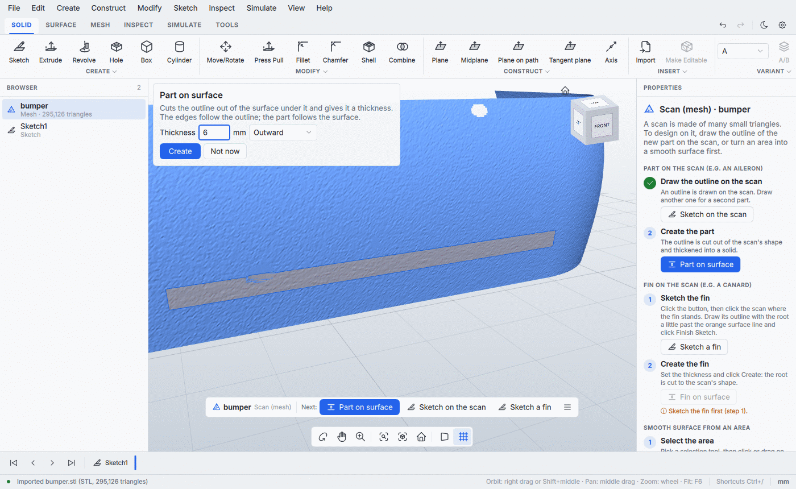
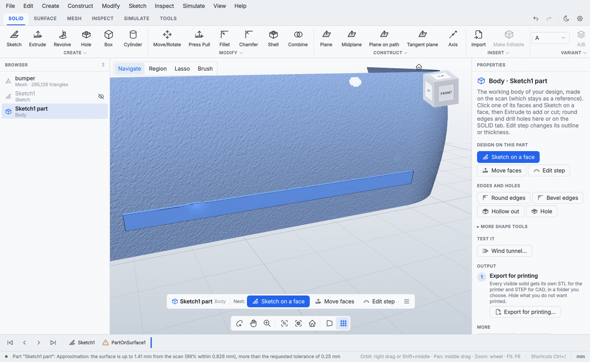

# 3. Create the part

**Goal:** turn the outline into an editable solid body that follows the scan.

## Steps

1. After **Finish Sketch** the panel **Part on surface** opens at the top left of the view. (If you
   closed it, select the scan or the sketch and click **Part on surface** in the guide.)

    

2. Set the two values:
    - **Thickness** in millimetres. The example uses `6`. (The default is 2.)
    - **Direction**: **Outward** (default: the part stands out of the scan, a layer on top of it),
      **Inward** (into the scan) or **Both sides, centred**. A lip, a canard base or a splitter
      stands *out* of the car, so keep **Outward**.
3. Click **Create**. The cut and fit take a few seconds on a large scan.

## What happened

- A new part `Sketch1 part` appeared in the Browser as a **Body** and is selected. It is
  an exact solid: its edges follow your outline and its skin follows the scan.
- The scan stays visible as a reference. Hide it with the eye icon in the Browser or press ++v++ with
  the scan selected, when you want to see the part alone.
- The timeline gained a step `PartOnSurface1`.
- The status bar names the part. The guide in Properties now lists what you can do with a body:

| Group | Buttons |
|---|---|
| Design on this part | **Sketch on a face**, **Move faces**, **Edit step** |
| Edges and holes | **Round edges**, **Bevel edges**, **Hollow out**, **Hole** |
| More shape tools | Combine, Split, Replace face, Align, Delete faces, Draft (folded) |
| Test it | **Wind tunnel…** |
| Output | **Export for printing…** |

Press ++a++ with the part selected to give it its own colour; the scan and the part look alike by
default.

## The "Approximation" warning

You may see in the status bar, and as an orange triangle on the `PartOnSurface1` step in the timeline:

> Part "Sketch1 part": Approximation: the surface is up to 1.41 mm from the scan (99% within 0.828 mm), more than the requested tolerance of 0.25 mm

AeroCAD fits the surface to the scan with a tolerance of 0.25 mm. On a noisy scan, or a scan that has
two layers (an inner skin behind the outer one), the smooth surface cannot be that close everywhere.
The part is kept and marked as an approximation. What to do:

- Check the numbers: "99 % within 0.83 mm" means almost all of the surface is within a millimetre.
  For a splitter or a canard that is usually fine.
- If the maximum is much larger than the 99 % value, the outline probably covers a hole or an edge of
  the scan. Move or shrink the outline (edit `Sketch1`).
- A scan whose noise is the only reason is *not* flagged: AeroCAD estimates the scan's own noise and
  lets the surface run through the middle of it.
- The export check repeats the warning when you export (step 7).

## Edit the part later

Select the part and click **Edit step** (or double-click `PartOnSurface1` in the timeline). The
dialog has the outline sketch, thickness and direction, and the aero shaping of
[step 5](step-5-shape.md). OK rebuilds the part and everything after it.

## Check

- [x] The Browser lists `Sketch1 part` as **Body** and it is selected.
- [x] You can see it on the scan (hide the scan to check).
- [x] The timeline shows `PartOnSurface1`.

Next: [4. Sketch on the curved face](step-4-sketch.md).
