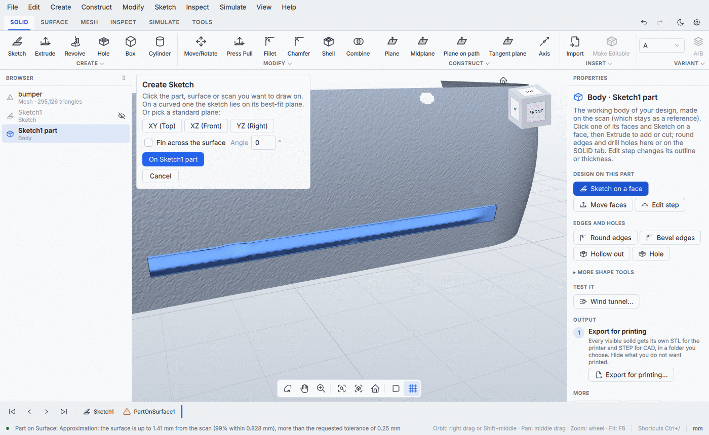
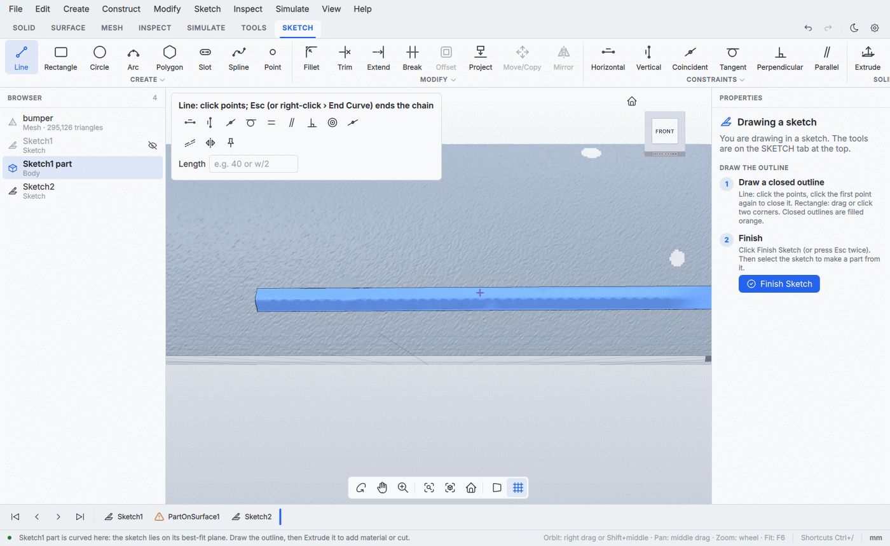
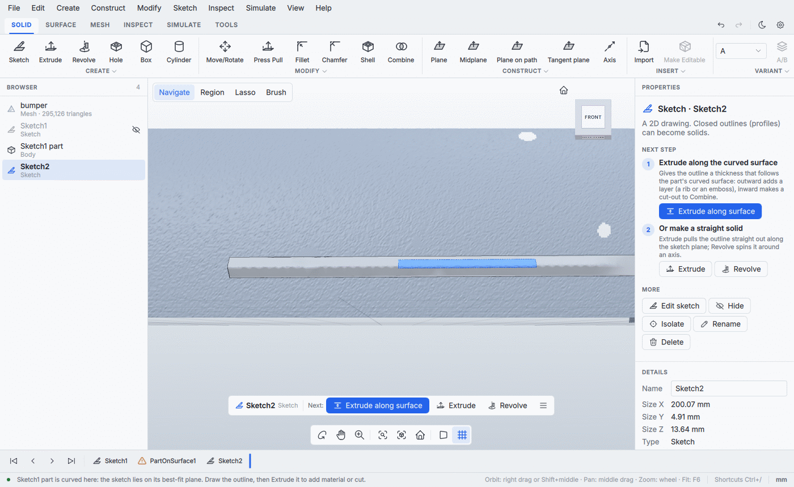
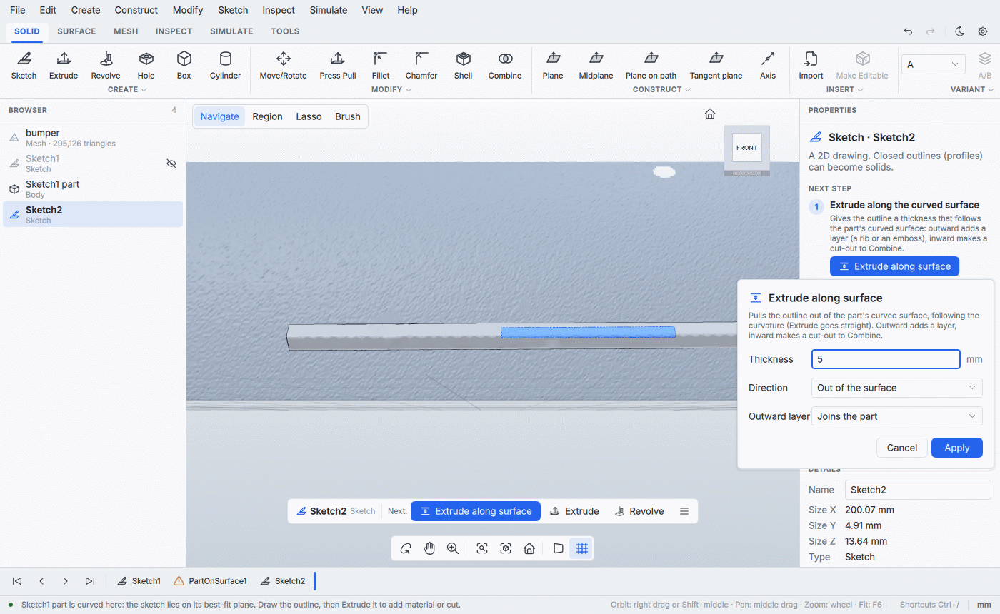
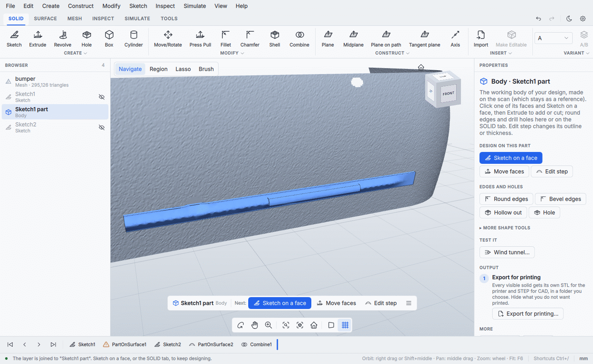

# 4. Sketch on the curved face and extrude along the surface

**Goal:** add a feature to the part by drawing on its curved face, for example a small rib (a Gurney
flap) on top of the lip.

A normal extrude pulls a sketch *straight* out of a flat plane. The part's face is curved, so a
straight extrude would stand off the skin everywhere except at one point. **Extrude along surface**
gives the outline a thickness that *follows the curvature* of the part.

## Steps

1. Select the part (`Sketch1 part`). Click **Sketch on a face** in the guide.
2. The panel **Create Sketch** asks you to click the part. Click **the face of the part** (its
   outer face, the one you see). Click the part, not the scan behind it.

    

3. The **SKETCH** tab opens and the view looks straight at the face. The status bar says:
   *"Sketch1 part is curved here: the sketch lies on its best-fit plane. Draw the outline, then
   Extrude it to add material or cut."*
4. Draw a closed outline. The example: **Rectangle** (++r++), click a corner inside the part, move
   the pointer right, type `200, 12`, ++enter++. Keep the outline *inside* the part's face.

    

5. Click **Finish Sketch**. The new sketch (`Sketch2`) is selected, and the guide leads on with
   **Extrude along the curved surface**:

    

6. Click **Extrude along surface**. A small dialog opens:

    

    | Field | Meaning |
    |---|---|
    | **Thickness** (mm) | How far the layer stands out of (or goes into) the surface. The example uses `5`. |
    | **Direction** | **Out of the surface**: adds a layer (a rib, an emboss). **Into the surface**: makes a cut-out you can use with **Combine**. **Both sides, centred**. |
    | **Outward layer** | **Joins the part** (default): the layer becomes part of the body. **Separate body**: keeps it as its own body. |

7. Click **Apply**. The view frames the result.

The status bar says: *The layer is joined to "Sketch1 part". Sketch on a face, or the SOLID tab, to
keep designing.* The timeline now reads `Sketch1`, `PartOnSurface1`, `Sketch2`, `PartOnSurface2`,
`Combine1`. One **Undo** (++ctrl+z++) removes the whole extrusion.

## More ways to design on the part

The part is a normal body, so all CAD tools work on it:

- **Extrude** (++e++): a straight extrusion of a sketch, for flat features.
- **Round edges** / **Bevel edges** (++f++): select an edge, set the radius.
- **Hole** (++h++), **Hollow out** (shell), **Combine** (join, cut, intersect with other bodies),
  **Move faces** (press-pull), **Split**, **Replace face**.
- **Sketch on a face** again, on the new layer, to stack features.

Each dialog shows a live preview; **OK** keeps it, **Cancel** or ++esc++ discards it.

## Check

- [x] The timeline shows the new steps and no red entries.
- [x] The rib stands on the lip and follows its curve (look along the part from the side).

Next: [5. Shape it (aero)](step-5-shape.md).
