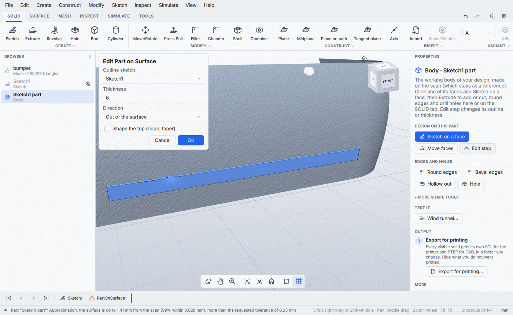
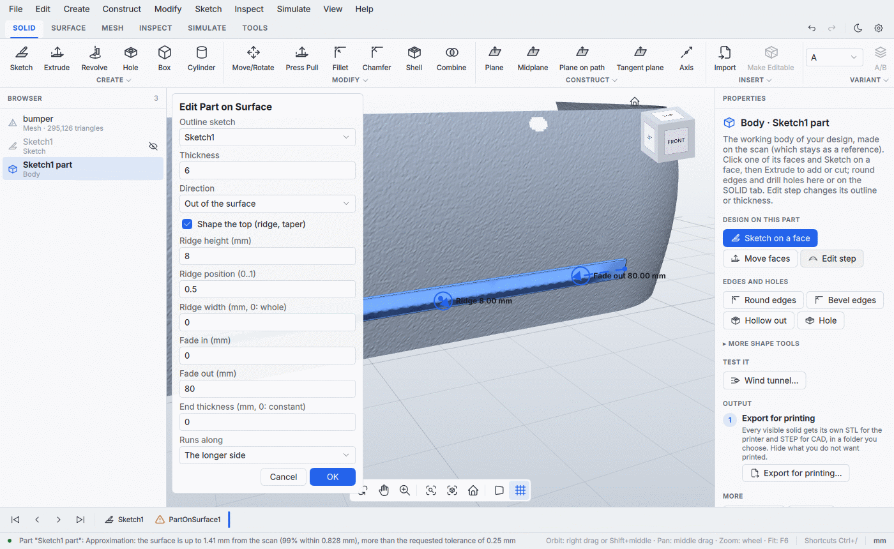
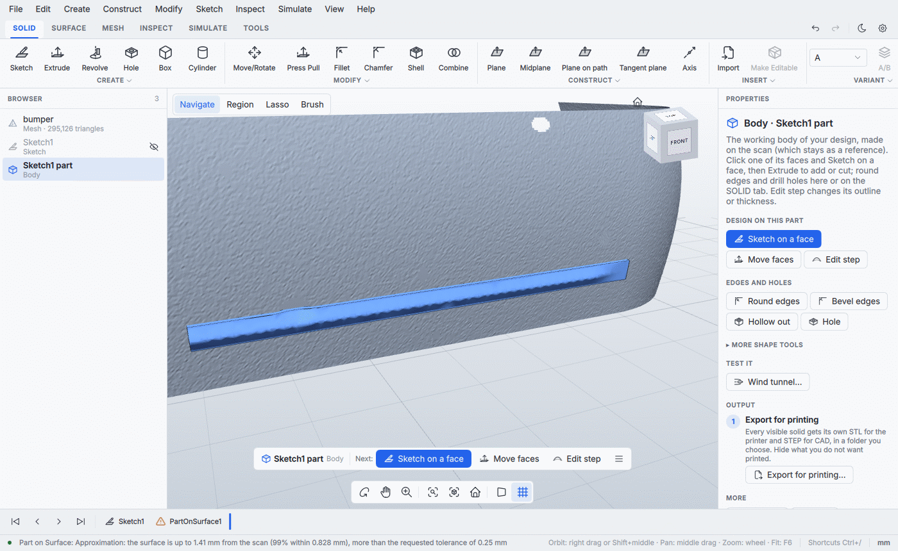

# 5. Shape it like an aero part

**Goal:** a constant-thickness plate becomes a profile: a ridge that fades
out, or a plate that tapers.

All of this is in one place: the **Part on Surface** step of the part.

## Steps

1. Select the part and click **Edit step** (or double-click `PartOnSurface1` in the timeline).

    

2. Tick **Shape the top (ridge, taper)**. More fields appear, and **arrows** show in the 3D view.
3. Set the numbers. The example: **Ridge height** `8`, **Fade out** `80`.

    

4. Click **OK**. The part rebuilds (a few seconds) and everything built on it rebuilds too.

## The fields

| Field | What it does |
|---|---|
| **Outline sketch** | The sketch that gives the part its shape. Change it to use another outline. |
| **Thickness** | The plate's thickness (mm). |
| **Direction** | Out of the surface, into the surface or both sides. |
| **Ridge height (mm)** | How far the ridge stands on top of the outer surface of the plate. `0` means no ridge. |
| **Ridge position (0..1)** | Where the ridge line runs *across* the part: `0.5` is the middle. The ridge runs along the longer side of the outline (or the direction chosen in **Runs along**). |
| **Ridge width (mm, 0: whole)** | The width of the ridge. `0` means the whole part. |
| **Fade in (mm)** | The length along the part over which the ridge rises from nothing. |
| **Fade out (mm)** | The length along the part over which the ridge falls to nothing. |
| **End thickness (mm, 0: constant)** | Taper: the thickness at the far end of the part. `0` keeps the thickness constant. |
| **Runs along** | The direction of the fades and the taper: **The longer side** (default), **Sketch X** or **Sketch Y**. |

The ridge follows the *actual* outline: for a trapezoid or a rounded outline it ends at the edge of
the outline, not at a bounding rectangle. The cross section is a smooth bump with no kinks, so the
airflow sees no sharp steps.

## Drag instead of type

With **Shape the top** ticked, three arrows are drawn on the part: **Ridge height**, **Fade in** and
**Fade out**, each with its current value. Drag an arrow and the field changes, and the preview
follows. Typing a value works the same way.

## Examples to start from

| Wanted | Settings |
|---|---|
| A flat splitter lip | No shaping, thickness 4 to 8 mm |
| A smooth bump that rises and falls along the part | Ridge height 8, ridge position 0.5, fade in 60, fade out 80 |
| A wedge that gets thinner | Thickness 8, **End thickness** 2 |

These are starting values, not recommendations from a test. Compare designs in the wind tunnel
(step 6) with [A/B variants](example-ab.md).

!!! note "Limits"
    The part must stay at least 0.2 mm thick. Shaping is available for a part made on a scan.

## Other shaping tools

The CAD tools of step 4 shape the part further: **Round edges**, **Bevel edges**, **Hollow out**
and **Draft**. For wings and strakes built from scratch the SOLID and SKETCH tabs also have **Loft**,
**Sweep** and **Airfoil** (a NACA 4-digit section or a `.dat` file as a sketch profile); see
[CAD reference](../cad.md).

## Check

- [x] The status bar after OK mentions no error.
- [x] The part is visibly thicker where the ridge is.
- [x] The timeline shows no red step.

Next: [6. Wind tunnel](step-6-cfd.md).
