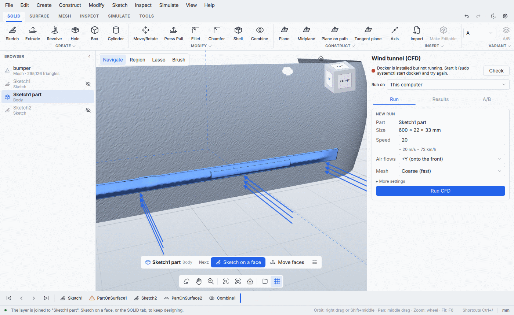
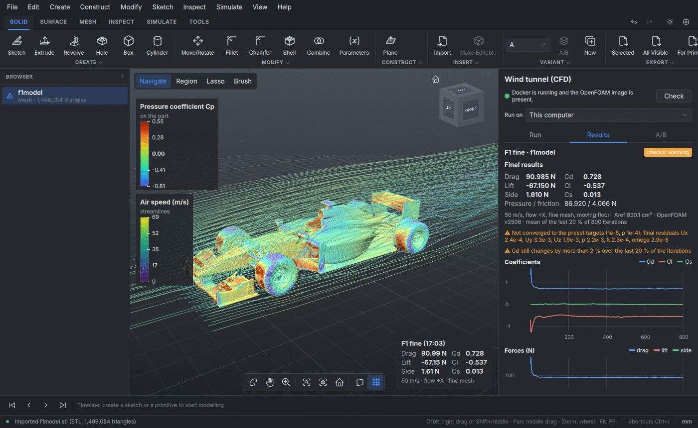
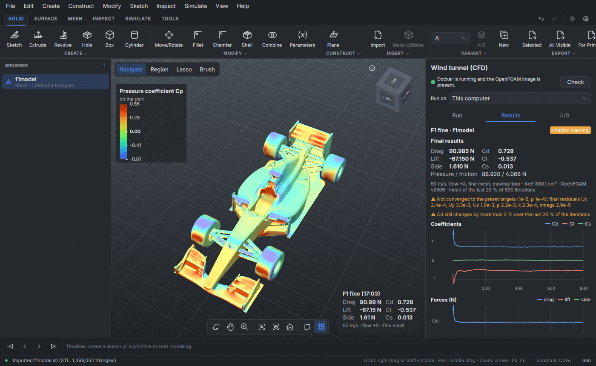

# 6. Test it in the wind tunnel

**Goal:** see the drag, the lift (downforce) and the pressure on your part, and compare designs.

AeroCAD runs **OpenFOAM v2506** (steady RANS, k-omega SST) in Docker on your own computer, in a
virtual wind tunnel built around the part. You need the engine once: see
[Install and run](install.md#the-wind-tunnel-engine-docker).

## Set up the run

1. Select the part (`Sketch1 part`) and click **Wind tunnel…** in its guide, or open the toolbar tab
   **SIMULATE** and click **Wind Tunnel**. The panel **Wind tunnel (CFD)** replaces Properties.

    

2. **Engine status** (top of the panel). A green dot means *Docker is running and the OpenFOAM image is
   present*. A red or orange line says what is missing; click **Check** to test again, or **Install
   for me** to let the program do the next step (see the install page). The screenshot above was taken
   on a computer without a running Docker, so the dot is red.
3. **Run on**: *This computer* (default). Another machine can be connected as a remote engine.
4. On the **Run** tab, **New run**:

    | Field | What to set |
    |---|---|
    | **Part** and **Size** | The selected part and its size. Check the size: a part under 20 mm or over 50 m gets a warning. |
    | **Speed** | `20` means 20 m/s. You can type a unit: `72 km/h`, `45 mph`. The line under it shows the speed in m/s and km/h. Above 150 m/s is refused. |
    | **Air flows** | The direction of the air: **+Y (onto the front)**, **-Y (onto the back)**, **+X**, **-X**. *Look at the blue arrows in the view*: they must hit the part from the front of the car. |
    | **Mesh** | **Coarse (fast)** for quick comparisons, **Medium**, **Fine (slow)**. |

5. **More settings** (click to open) holds the rest:
    - **Yaw (°)**: turn the air for a crosswind or a car in a corner (-30 to 30).
    - **Ref. area (cm²)**: the area Cd and Cl are computed on. Empty uses the frontal area.
    - **Label**: a name for the run.
    - **Moving floor under the geometry** (off by default) and **Floor at Z (mm)**: a road that moves
      with the air. For a part on a car, give the height of the road in the model's coordinates; empty
      puts it just below the parts.
    - **Rotating wheels (on the floor)**: for a whole car with wheels on the floor.
    - **Other visible parts in the flow (not in the forces)**: see the next section.

6. The tunnel (dashed box) and the arrows in the 3D view show the planned set-up *before* you run, so
   a wrong direction is visible at once.

### The part alone, or the part on the car?

A lip floating alone in the air does not behave like a lip on a bumper. To put the car in the flow,
keep the scan visible and tick **Other visible parts in the flow (not in the forces)** under *More
settings*. The scan is then in the flow as surroundings, and the forces reported are those of the
**selected part only**. Hide anything that should not be in the flow (eye icon in the Browser) first.

!!! warning "Open scans"
    A scan that is an open shell (holes, a one-sided bumper) is warned about in the panel, with the
    number of open edges: the mesher cannot tell inside from outside and wraps the shell in a layer
    about one cell thick. Close it first with **MESH > Scan Tools > Repair** (increase *Fill holes up
    to*), or use a closed part.

## Run

Click **Run CFD**. The run starts in the background:

- The run list below the form shows the state and progress (meshing, then solver iterations).
- You can keep working; the run continues even if you close the panel or the program, and is picked up
  again at the next start.
- A coarse run of a small part takes a few minutes, a fine run of a whole car hours. Measured on four cores: three coarse runs of a 200 mm box finished within about 95 seconds, and the F1 model on a fine mesh took about 4 seconds per iteration (800 iterations at most). Fewer cores or a smaller Docker/Colima VM are slower. The run list shows how long it has
  run and, while solving, at most how long is left; it often stops sooner when it converges.
- Several runs share the processors; more than fit wait in a queue and start by themselves.
- **Cancel** stops a run (asked first; a stopped run cannot be resumed). **Delete** removes the run
  and its files (asked first).

Runs are stored in `~/.aerocad/cfd/`, per user, not per project.

## Read the results

Click the run, then the **Results** tab.

*(Screenshot: a finished run on the F1 model, 50 m/s, fine mesh, moving floor.)*

| Item | Meaning |
|---|---|
| **Drag**, **Lift**, **Side** (N) | Final forces: the mean over the last 20 % of the iterations. "± x" is how far the force still swings. A negative lift is **downforce** and is marked so. |
| **Cd**, **Cl**, **Cs** | The same as coefficients on the reference area. |
| **Efficiency L/D** | Lift (absolute value) divided by drag. |
| **Pressure / friction** | The two parts of the drag in N. |
| **At speed** | Type another speed to scale the final forces to it (by speed squared, with the run's own Cd and Cl). |
| **checks: ok / warning** | The quality verdict: mesh check, convergence, residuals, force stability. A warning lists what failed, for example *Not converged to the preset targets* or *Cd still changes by more than 2 % over the last 20 % of the iterations*. |
| **Coefficients**, **Forces**, **Residuals** charts | Per iteration, updated live while the run is going. Hover to read values. |

**Show in 3D** (further down the Results tab) draws the result on the model: **Surface pressure
(Cp)** on the part, **Streamlines (speed)**, sections of the air speed, the **wake** and **vortex
cores**. Choose the pressure colours (**Rainbow** or **Blue–white–red**), the streamline colours
(**Speed** or **Smoke (grey)**) and the Cp range (**Auto** or fixed). The Cp colours and the
streamlines are on by default.

**Export CSV…** writes the numbers of the run.

## How far to trust the result

A coarse mesh is for *comparing* two designs under identical conditions, not for absolute numbers.
The preset is checked against the Ahmed body experiments; see
[CFD validation](../cfd-validation.md). Read the *checks* badge of every run. A difference between
two runs that is smaller than their swing is shown as "noise", not as a result. The A/B tab can
re-run both on a finer mesh to check that a difference holds
([A/B example](example-ab.md)).

## Check

- [x] The arrows in the view hit the front of the part.
- [x] The run finished, and the badge reads *checks: ok* (or you understand the warning).
- [x] Drag and lift have the sign and size you expect (a negative lift is downforce). If not, check
  the air direction and the units first.

Next: [7. Export and save](step-7-export.md).
