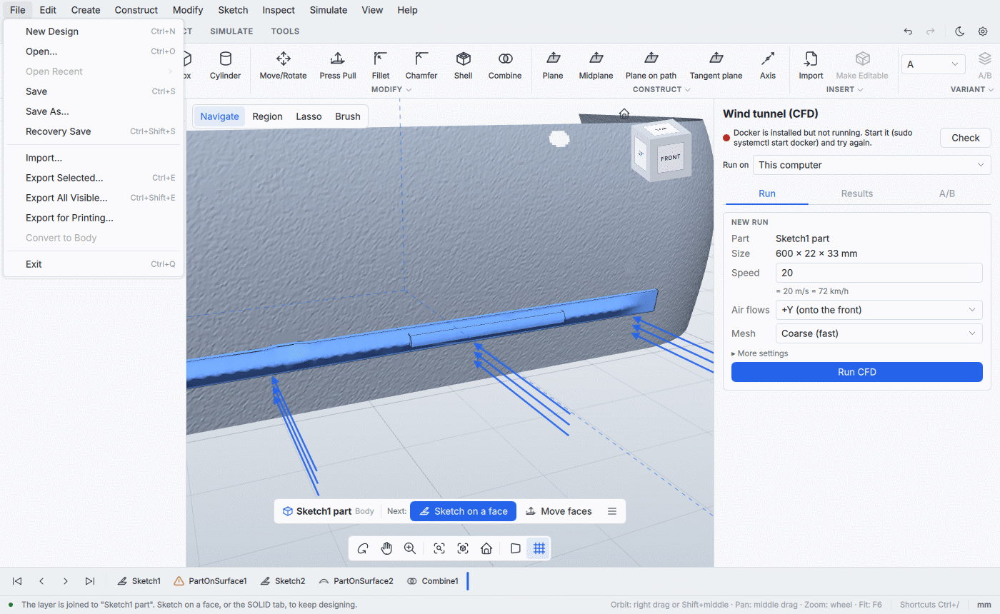
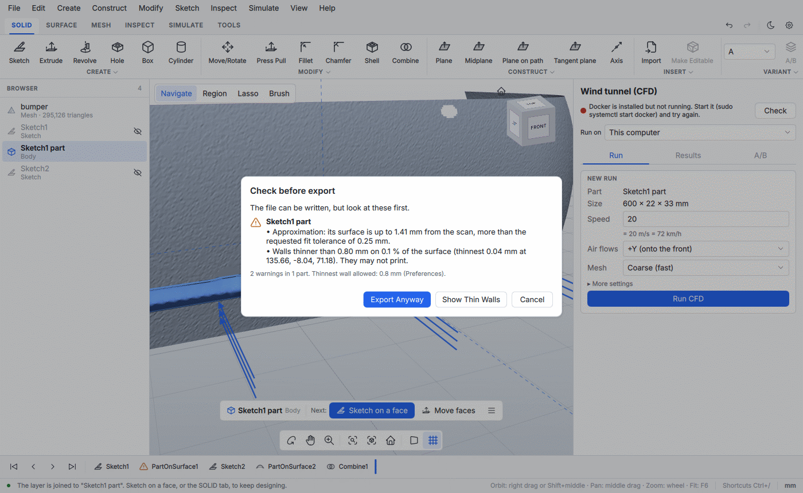
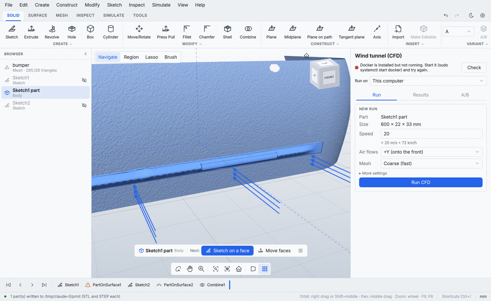

# 7. Export and save

**Goal:** files for the printer (STL) and for other CAD programs (STEP), and a project you can reopen.

## Export for printing

1. Make sure only the parts you want are **visible** (Browser eye icons). Hide the scan and sketches.
   Every visible solid is exported.
2. Click **Export for printing…** in the part's guide (under *Output*), or menu
   **File > Export for Printing...**.

    

3. Choose a **folder**. AeroCAD checks the parts first (next section), then writes **one STL and one
   STEP file per solid**, named after the part: `Sketch1 part.stl` and `Sketch1 part.step`.
4. The status bar reports: *1 part(s) written to <folder> (STL and STEP each)*.

## The export check

Before anything is written, AeroCAD checks each part and shows **Check before export** when it finds
something:

| Warning | What it means | What to do |
|---|---|---|
| **Approximation: its surface is up to X mm from the scan** | The part was fitted within more than the 0.25 mm tolerance (see [step 3](step-3-part.md#the-approximation-warning)). | Usually fine for a part that only has to fit well; check the numbers. |
| **Walls thinner than 0.80 mm on N % of the surface** | Places the printer may not print. The dialog gives the thinnest wall and where it is. | Click **Show Thin Walls** to see them, then thicken the part (Edit step) or round the sharp edge that makes the sliver. |
| **Reaches behind the scan surface by up to X mm** | Part of the body is on the far side of the scan it was drawn on, so it may collide with the car. Shown only when at least 1 % of its points are more than 0.5 mm behind. | Move or thin the part so it stays on the outside of the scan. The part on the inside of the scan (the default of Part on surface) is not compared. |

The thinnest wall allowed (0.8 mm) can be changed in Preferences. The buttons: **Export Anyway**
writes the files as they are, **Show Thin Walls** colours the thin places in the view, **Cancel**
stops.

A big part (a whole-car scan) takes a few seconds to check and write. The check runs in the
background: a bar at the top of the view shows what is being checked, you can keep working, and
**Cancel** in the bar stops it before anything is written. The report belongs to the design as it
was when you started the export.

Some problems **block** **Export for printing** instead of warning: a part that is not a closed
solid (an open surface, or a mesh with open edges) cannot be printed, so the dialog lists the problem
without an *Export Anyway* button and nothing is written. Repair or close the part first. The plain
exports below (STL, 3MF, STEP of the selected or all visible parts) only *warn* about an open mesh and
still write the file, because a scan file or STEP geometry may be open on purpose.

## Other exports

- **File > Export Selected...** (++ctrl+e++): the selected part, as **STL**, **3MF** or **STEP**.
- **File > Export All Visible...** (++ctrl+shift+e++): every visible part in one file.

Choose **STEP** for other CAD software (colours and names are kept: one product per body), **STL** or
**3MF** for slicers. Sketches are never exported.

## Save and reopen

- **File > Save** (++ctrl+s++) / **Save As...** writes one `.aerocad` file: the scan, the whole
  timeline, selections, variants A/B and the camera view. The scan is stored in the file.
- Reopen with **File > Open** (++ctrl+o++) or **Open Recent**. The bodies are rebuilt from the timeline,
  so the design stays editable: **Edit step** still works.
- **Autosave**: while there are unsaved changes, a recovery copy is written every 2 minutes
  (**Preferences > Autosave**). If the program did not close properly, the next start asks *Recover
  unsaved changes?*.
- **File > New Design** (++ctrl+n++) starts from nothing and resets the whole state.

!!! note "Wind tunnel runs"
    Wind tunnel runs are stored per user in `~/.aerocad/cfd/`, not in the project file. Runs whose
    part is not in the open design are folded under *Runs from other designs* in the panel.

## Check

- [x] The folder contains an STL and a STEP file of the part.
- [x] You saved the project and can reopen it.

You have finished the golden path. For two more cases see the [examples](example-lip.md), and for
problems [Troubleshooting](troubleshooting.md).
