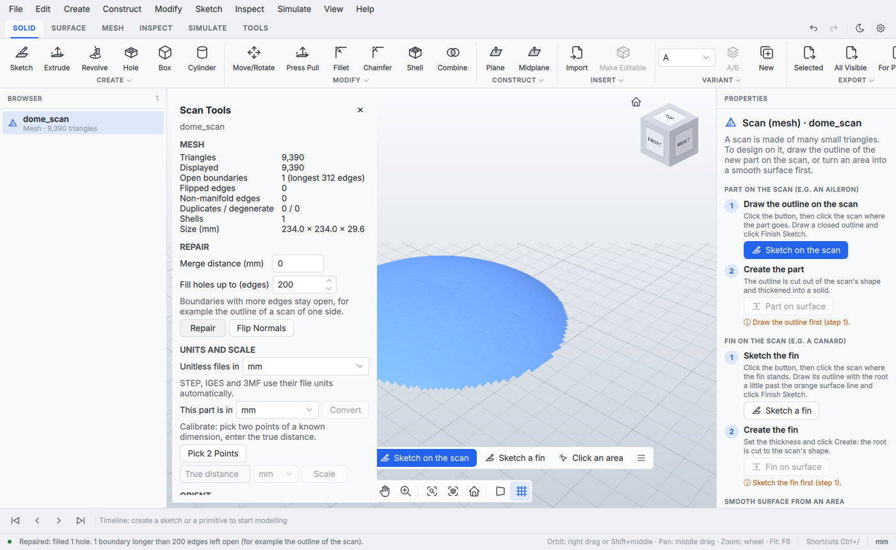

# Working with scans

3D scans arrive as big triangle meshes (often millions of triangles) in an unknown unit
and an arbitrary orientation, with holes and flipped or duplicated faces. These commands
make them usable as a reference for modelling. All of them are undoable and, like every
command, available to scripts and to an AI agent over MCP (`commands.list`).

## Units and scale

| Command | What it does |
| --- | --- |
| `document.import {"path", "units"}` | STL, OBJ, PLY and BREP use `units`: `um`, `mm` (default), `cm`, `m`, `in`, `ft`, and are scaled to millimetres. STEP, IGES and 3MF use their file units (including format defaults) and ignore this unitless-file setting. |
| `part.convert_units {"id", "from", "to"}` | Fix a part imported in the wrong unit: `from: "m"` scales by 1000 (about the world origin). `to` defaults to `mm`. |
| `part.calibrate {"id", "a", "b", "distance", "units"}` | Scale so that the distance between two points (picked on the model) equals a known dimension. Point `a` stays fixed. Returns the applied `factor`. |

In the app, a scan whose longest side is under 20 mm or over 50 m starts its guide with
"Check the size": it names the unit the file was most likely saved in (the one that makes it
0.1 to 10 m long) and converts it in one click (CAD-140).

File units are converted exactly once. A 10 × 20 × 30 mm STEP or 3MF model stays
10 × 20 × 30 mm even if the last unitless scan was imported in centimetres or inches.
The import result reports `unitSource: "file"` and `units: "mm"` for reader-normalized
STEP, IGES and 3MF coordinates; unitless formats report `unitSource: "importSetting"`
and the applied input `units`. `outputUnits` is always `mm`.
The setting does not override embedded units. If a file declares the wrong unit, apply
an explicit **Convert**, **Calibrate**, or **Scale** operation after import.

**Names and colours (CAD-227, CAD-228).** STEP export writes one product per body, named after
the body, with its Appearance colour; 3MF export writes each body's colour as a core-spec
`basematerials` display colour. Importing a STEP file with several bodies, or a 3MF file with
several build items, gives one part per body, named from the file (or "<file name> <n>" when
the file has no name), with the file's colours; one Undo removes them all. The result is the
first part, and `parts` lists every part the import made.

## Orientation

| Command | What it does |
| --- | --- |
| `part.align {"id", "points" \| "triangles" \| "normal"+"origin", "target", "origin", "xDirection", "flip", "keepPosition"}` | Fit a plane to 3+ picked points or to a triangle region (e.g. a selection), turn it onto a world plane (`xy` default: normal to +Z; `xz`: +Y; `yz`: +X) and move its origin to the world origin. `xDirection` fixes the in-plane rotation. Returns the 4x4 `transform` and the fit `fitRms`. |
| `part.transform {"id", "axis", "angle", "scale", "center", "translate"}` | Move, rotation (degrees, right-hand rule) and uniform scale; scale and rotation about `center` (default the box centre) first, then the move. |
| `part.face_orientation {"id", "point", "mode", "triangle", "radius", + a pending transform}` | Read-only: how to turn the part by the face at `point`. `down` lays it on that face on the ground (lowest point Z 0), `front` turns it about Z so the face looks at the Front view (-Y), keeping its height. The face direction is the normal of the patch around the point (cos^8-weighted, so bevels and noise do not tilt it). Returns `center`, `axis`, `angle`, `scale`, `translate` for `part.transform` / `feature.move`. Lay on Face and Face Front in the Move / Rotate / Scale tool use it. |
| `part.place {"id", "onFloor"}` | Centre the bounding box on the origin in X/Y and rest it on Z = 0 (or centre it in Z). |

To put a picked face of a scan on the floor, align with that face's triangles and
`flip: true`: its outward normal then points down and the object stands on the XY plane.

## Repair

| Command | What it does |
| --- | --- |
| `mesh.stats {"id"}` | Triangles, holes (boundary loops, every open border including the outline of a one-sided scan), `largestBoundaryEdges` (edges of the longest loop), `loopedBoundaryEdges` (boundary edges in closed loops; the rest are open chains, for example at non-manifold edges), boundary / non-manifold / inconsistent (flipped) edges, duplicate and degenerate triangles, unused vertices, shells, area, bounds. |
| `mesh.repair {"id", "mergeDistance", "removeDegenerate", "removeDuplicates", "fixOrientation", "maxHoleEdges"}` | Merge (close) vertices, drop degenerate and duplicate triangles, make the winding consistent (closed shells face outwards), fill holes up to `maxHoleEdges` edges, drop unused vertices. Returns the counts and the stats afterwards. |
| `mesh.flip_normals {"id"}` | Reverse every triangle. |
| `mesh.decimate {"id", "targetTriangles"}` | Permanently reduce the mesh (vertex clustering). Usually not needed, see below. |

Repair, flip and decimate refuse parts with exact CAD geometry (STEP/IGES/BREP) and
timeline bodies; they are meant for meshes.

Holes are filled by ear clipping in the hole's best-fit plane (no new vertices), which suits
the small, roughly planar holes typical of scans; a hole that does not project to a simple
polygon is left open and reported as `skippedHoles`. Loops longer than `maxHoleEdges` are left
open and counted in `largeBoundaries`. On a scan of one side of an object the longest loop is its
outline, so the Scan Tools panel lists "Open boundaries" with the longest loop's edge count, and the
Repair status says how many boundaries stayed open. Large holes (scanner shadows) are better closed by
modelling over them.

While Scan Tools picks points (calibrate, orient), a click next to the scan or on another part
keeps the points picked so far and shows a hint; it does not change the selection.

## Performance (5.1 M triangles, Release build, one core)

| Operation | Time |
| --- | --- |
| `decimateToTarget` to 1 M triangles | 0.7 s |
| `meshStats` | 1.4 s |
| `repairMesh` (all steps) | 3.0 s |

## In the app

- **Import** (toolbar, File > Import, drag & drop) parses files on a worker thread with a
  progress bar and a Cancel button; the part is then added through `document.import`.
  Set **Unitless files in** in Scan Tools for STL, OBJ, PLY and BREP. STEP, IGES and
  3MF use file units automatically, and their import status says **file units → mm**.
  The unitless-file preference is remembered, including when importing a mixed queue.
- **Scan Tools** (toolbar MESH > Scan Tools, Modify > Scan Tools; no shortcut, Fusion has none)
  acts on the selected imported part: mesh statistics, Repair / Flip Normals, unit
  conversion, Calibrate (Pick 2 Points, enter the true distance), Orient (Pick Points on a
  flat area, choose XY / XZ / YZ, Align; Place on Floor, Center). Picked points snap to the
  nearest vertex of the full-resolution mesh. Esc closes the panel.

## Display level of detail

Meshes above the "Max. triangles drawn" budget (Scan Tools > Display, default 1 M,
remembered between sessions) are drawn simplified by vertex clustering, computed in the
background. The simplified mesh is drawn with smooth (averaged) normals: its vertices are
averages per grid cell, and flat shading showed bands where the surface crosses a grid
plane (CAD-139). The document keeps the full mesh, so picking snaps, selection, fitting and
modelling always use all the scan data. A 5 M-triangle PLY imports and renders in about
5 s in the cloud CI container with software OpenGL.
