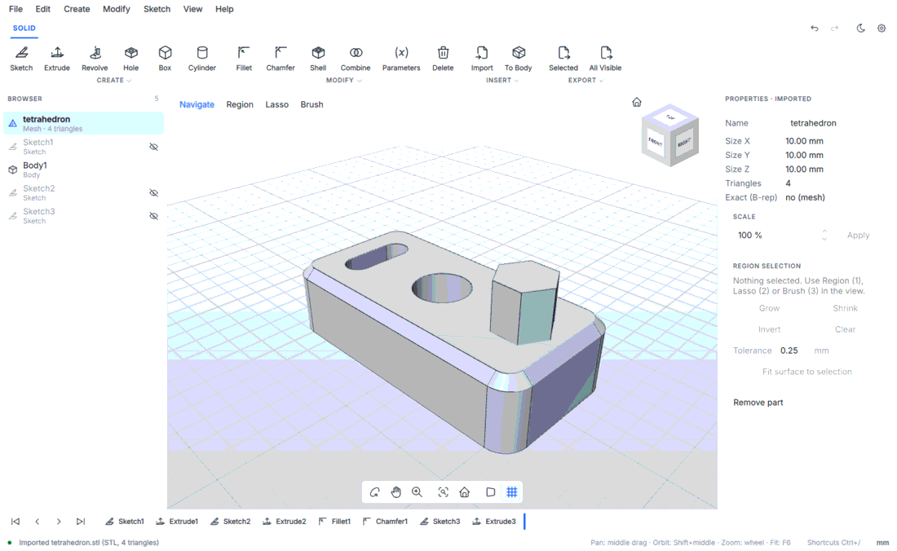
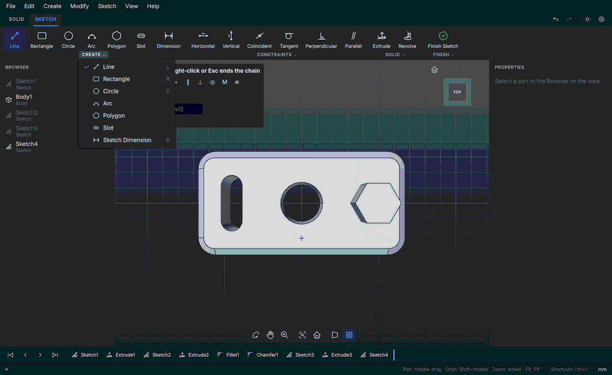
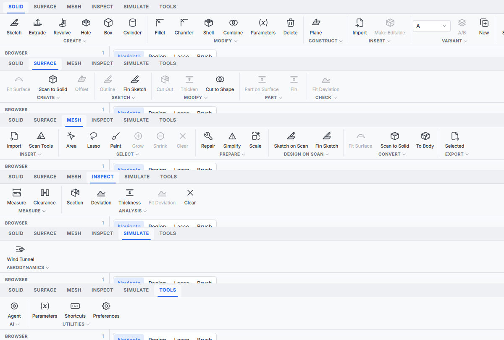
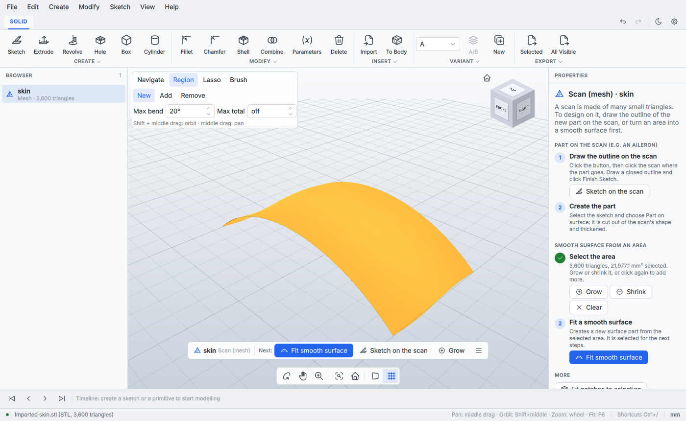
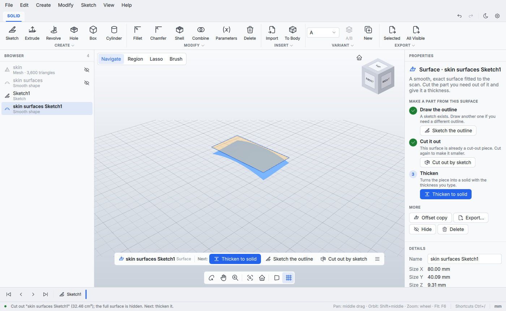

# User interface and shortcuts

AeroCAD's window follows the layout of common CAD applications, Autodesk Fusion in particular:

- **Toolbar** (top): one tab per kind of work, then command groups with icons and
  captions. Undo/redo, the light/dark switch and Preferences sit at the right end of the
  tab row. See [Toolbar tabs](#toolbar-tabs).
- **Browser** (left): the parts of the document.
- **Canvas** (centre): the 3D view with a ground grid, the **ViewCube** in the top-right
  corner and the **navigation bar** at the bottom centre.
- **Properties** (right), the **timeline** and the **status bar** (bottom).

The look is defined in one place, see [Design system](#design-system). What can be done
with the selected part is explained in the window itself, see
[Guided workflow](#guided-workflow).

Keyboard shortcuts and mouse navigation use Fusion's defaults so that Fusion users feel at home.
Sources: [Autodesk Fusion keyboard shortcuts](https://www.autodesk.com/shortcuts/fusion-360),
[Fusion 360 Camera Controls](https://help.autodesk.com/cloudhelp/2019/ENU/MSHMXR/files/GUID-61EE8C7A-F896-4C26-86B9-450247945FD1.htm),
[ViewCube reference](https://help.autodesk.com/cloudhelp/ENU/Fusion-GetStarted/files/GS-VIEWCUBE.htm),
[Fusion navigation (touchpad)](https://help.autodesk.com/cloudhelp/ENU/Fusion-GetStarted/files/GUID-7B742BB2-65B3-4ADA-9B11-9D57E1E31292.htm).

## Toolbar tabs

Each tab holds the commands of one kind of work, so no tab is crowded. Commands past
a group's first few are in the drop-down under its caption.

| Tab | Groups | For |
|---|---|---|
| SOLID | CREATE, MODIFY, CONSTRUCT, INSERT, VARIANT, EXPORT | Parametric solids in the timeline: sketch, extrude, fillet, combine, export |
| SURFACE | CREATE, SKETCH, MODIFY, PART, CHECK | Smooth surfaces fitted to a scan and parts made on them: fit, outline, cut out, thicken, part on surface, fin |
| MESH | INSERT, SELECT, PREPARE, DESIGN ON SCAN, CONVERT, EXPORT | Scans: Scan Tools, area selection, repair, simplify, scale, sketch on the scan, fit or convert |
| INSPECT | MEASURE, ANALYSIS | Measure, clearance, section, deviation and thickness maps |
| SIMULATE | AERODYNAMICS | Wind tunnel (CFD) |
| TOOLS | AI, UTILITIES | AI agent access, parameters, shortcuts, preferences |
| SKETCH | CREATE, CONSTRAINTS, SOLID, FINISH | Shown only while a sketch is edited |

The SURFACE and MESH commands are the guided actions of the selected part (the same as in
the context bar and the right-click menu, see [Guided workflow](#guided-workflow)). They
are enabled when they apply to the selection; otherwise the tooltip says what to select.
Commands that need values (e.g. Thicken) open the same small form as the context bar.
Clicking another tab while a sketch is edited finishes the sketch.

## Mouse and touchpad

| Action | Mouse | Touchpad / Magic Mouse |
|---|---|---|
| Orbit | Shift + middle drag, or right drag | Shift + two-finger swipe |
| Pan | Middle drag, or Shift + right drag | Ctrl (⌘) + two-finger swipe |
| Zoom | Wheel | Two-finger swipe up/down, or pinch |
| Select | Left click | Click |
| Context menu | Right click (without dragging) | Two-finger click |
| Zoom to a part | Double click on it | Double click on it |
| Fit all | Double click on empty space, or middle double click | Double click on empty space |

Zoom moves towards the point under the pointer and keeps it there, so the wheel brings in
whatever you point at. Dragging to orbit turns the view around the point of the model under
the pointer when the drag starts (around the view centre when it starts next to the model).

Right drag is not in Fusion's default scheme: it is there for mice without a middle button
(Magic Mouse, most Mac mice) and for touchpads. A right click that does not move still opens
the context menu, as in Rhino and Onshape.

On macOS every mouse wheel also reports a pixel delta; only devices that macOS marks as
smooth-scrolling (trackpads, Magic Mouse) count as a touchpad, so a mouse wheel always
zooms. **Edit › Preferences › "Two-finger scroll on a touchpad pans"** makes the touchpad
swipe pan instead (pinch and Ctrl + swipe then zoom).

The left button is reserved for selection. The navigation bar's **Orbit**, **Pan** and **Zoom**
tools temporarily map left drag to that navigation (useful without a middle button); click the
tool again to turn it off.

As in Fusion, the part under the pointer is drawn **highlighted** (a light blue tint over its
grey; planes and sketch profiles a lighter blue) so it is clear what a click picks. The
selected part keeps its stronger selection blue. Only parts that can be picked at that moment
are highlighted (while a command asks for a plane, a body is not), and nothing is highlighted
while a mouse button is held (orbit, pan, a drag), with the Region, Lasso or Brush tools, or
in a sketch.

**Zoom to selection** fills the view with what is selected: the selected area of a scan
(Region, Lasso, Brush) when there is one, else the selected part. It is in the navigation bar
(next to Fit all), in **View › Zoom to Selection**, and a double click on a part does it for
that part. A part being moved with Move / Rotate / Scale is framed where it is shown. A double
click on empty space, or with the middle button anywhere (as in Fusion), fits everything.
Single letters are Fusion's modelling keys (F is Fillet), so zooming to the selection has no
key of its own.

The table is the default (Fusion) scheme. **Edit › Preferences › Mouse** switches the
middle button to other common schemes; the status bar and Help › Keyboard Shortcuts follow
the choice:

| Scheme | Orbit | Pan | Zoom |
|---|---|---|---|
| Fusion (default) | Shift + middle drag | Middle drag | Wheel |
| SolidWorks | Middle drag | Ctrl + middle drag | Wheel, Shift + middle drag |
| Blender | Middle drag | Shift + middle drag | Wheel, Ctrl + middle drag |

On macOS, Ctrl here is the Command key (Qt's mapping). "Reverse zoom direction" flips the
wheel and drag zoom; "Reverse orbit direction" flips orbiting. By default the model follows
the pointer or the fingers, the same way for the mouse and the touchpad.

## Right-click menu

The menu lists only what can be done with what is under the pointer:

- **On a part**: its type and name, the recommended next step (★, the same as in the
  guide), the other steps that can be done now (at most five, the rest under **More**),
  then **Move / Rotate / Scale** (M), **Zoom to this**, **Hide** / **Show** (V) and **Delete** (Del).
  Disabled actions are left out; the guide in Properties says why something is not possible
  yet.
- **On empty space**: **Fit All** (F6), **Home View**, **Orthographic** / **Perspective**,
  **Show All Parts** when something is hidden, **Undo** / **Redo**, **Import** and
  **New sketch**.
- **In a sketch**: the sketch menu (see Sketch below).

## Command search

Press **S** (as in Fusion) for a small search box at the pointer. Type part of a command's
name, or of its menu ("sketch", "export"): Up / Down pick a result, Enter runs it, Esc
closes the box. Each result shows its menu and shortcut. Commands that cannot run right now
(nothing selected, for example) are listed last and dimmed. The list is read from the menus
when the box opens, so every menu command can be found. In a text field S is typed as text.

## Browser

The Browser lists the parts of the document. Click a row to select the part, hover it to
show its eye (Show / Hide, also V), right-click it for the part's menu (Hide, Rename, Delete
and the part's commands). **Rename** a part in place: double-click its name, press **F2**
with the part selected, or choose Rename in its right-click menu. Enter or clicking
elsewhere applies the name (one undo step); Esc keeps the old one. While a name is typed,
the keys go to the text only (V, M, Delete do not act on the part). A renamed timeline body
keeps its name when the timeline is edited and in the saved project. The rows are in the order
the parts were made: a part brought back by Undo (a delete undone, a feature unsuppressed
or the timeline rolled forward) returns to its own row, not to the end of the list.
**Isolate** (right-click menu, or View › Isolate) shows only that part and hides the
others, as in Fusion; the Browser shows "Isolated: …" with an **Exit** button. Exit, View ›
Unisolate or Unisolate in the isolated part's menu shows again exactly the parts it hid (a
part hidden before stays hidden). Undo of Isolate also ends it.
**Appearance** (key **A** as in Fusion, Edit › Appearance or the part's right-click menu)
gives a body or scan its own colour from a row of swatches, so parts are told apart in a
crowded scene; the Browser icon takes the colour too. *Default* goes back to grey. It is one
undo step, timeline bodies keep it through edits, and it is saved with the project.

## Copy and paste

**Edit › Copy** (Ctrl+C) and **Paste** (Ctrl+V) copy the selected body or scan, as in Fusion:
the copy is added, selected and opened in Move / Rotate / Scale, so it can be dragged into
place and applied with Enter. Esc right after pasting removes the copy again. A body of the
timeline is copied as a fixed solid (its shape, not its features). Sketches and planes are
not copied. In a text field Ctrl+C / Ctrl+V copy and paste text.

## Move / Rotate / Scale

**Move / Rotate / Scale** (SOLID › MODIFY, MESH › PREPARE, MESH › Scale, right-click menu,
key M as in Fusion's Move/Copy) works directly in the view, with no dialog to confirm each
change:

- **Arrows** (red X, green Y, blue Z) move the part along that axis; **rings** turn it about
  that axis through its centre (the point of the ring you grab follows the pointer, also on
  a ring seen at a slant, and a drag round the ring keeps turning); the **white square** in the middle scales it evenly. Hold
  **Shift** while dragging to snap (1 mm, 15°, 5 %). The value shows next to the pointer.
- The part follows live. A small panel (top left of the view) shows the exact Move (mm),
  Rotate (° about X, then Y, then Z) and Scale (%); typing a value previews it at once.
  When a typed Move or Scale takes the part out of view (scaled up around the camera,
  shrunk to a dot or moved off screen), the view frames the preview; Fit (F6) during the
  tool frames the preview too.
- **Enter** or **Done** applies everything as one undo step; **Esc** or **Cancel** puts the
  part back; **Reset** clears the values. Clicking another part or empty space, or starting
  another command, applies it too. Ctrl+Z / Cmd+Z during the tool drops the preview.
- **Lay on Face**, then a click on a face of the part: the part turns so that face points
  down and drops onto the ground (Z = 0), like "lay on face" in a slicer.
- **Face Front**, then a click on a face: the part turns about the vertical axis so that face
  looks at the Front view, which is where the air comes from in a wind tunnel run with the
  default flow (+Y); its height stays. A face pointing up or down is turned onto the front
  directly. Together they set a part up for CFD in two clicks.
  On a scan the face direction is taken from the surface patch around the click (3 % of
  the part size), so scanner noise does not tilt the part. Esc leaves the face pick. The
  geometry comes from the `part.face_orientation` command, which AI agents can use too.

On a body the result is a timeline step (`feature.move`, editable later); on a scan,
surface or imported solid it changes the part directly (`part.transform`). Sketches and
planes move with the body they belong to.

## Preferences

Edit › Preferences (⌘, on macOS; on macOS Qt moves it into the application menu). Changes
apply immediately and are stored per user (QSettings, organisation "FlappedEar").

- **Length unit**: mm, cm, m or in for displayed lengths (properties panel, sketch
  dimensions while drawing). Input fields, files and commands always use millimetres.
- **Theme**: follow the system, light or dark. Everything switches together, including
  the 3D view background, grid, ViewCube and menus. The sun/moon button in the tab row
  switches between light and dark directly.
- **Mouse**: navigation scheme, see above.
- **Autosave**: interval in minutes, or off. Stored as `project/autosaveSeconds`, the key
  the project autosave reads.

Help › Keyboard Shortcuts (Ctrl+/) lists every menu command with a shortcut, read from
the menus when it opens, plus the viewport keys and the mouse scheme. It has a search field.

## ViewCube

- Click a **face** for that orthographic standard view (Front, Back, Left, Right, Top, Bottom).
- Click an **edge** or a **corner** for the view between the adjacent faces (corners give
  isometric views).
- **Drag** the cube to orbit. Orbiting has no stop at Top or Bottom: it goes over the pole.
- The **arrows** around the cube (shown on hover) turn the view by 90° up, down, left or
  right, and keep going past Top and Bottom.
- The **house** icon goes to the Home view (default: isometric from front-right-top), framed to fit.
- **Right-click**: Go Home, Orthographic / Perspective, Set current view as Home, Reset Home.

Model space is Z-up: Front looks along +Y, Right along -X, Top along -Z.

## Keyboard shortcuts

Qt maps Ctrl to Command and Alt to Option on macOS, so "Ctrl+Alt+V" is Option+Command+V on a Mac.

| Command | Windows / Linux | macOS | Fusion default? |
|---|---|---|---|
| New Design | Ctrl+N | Cmd+N | yes |
| Open (projects and 3D files) | Ctrl+O | Cmd+O | yes |
| Save | Ctrl+S | Cmd+S | yes (Save Version) |
| Recovery Save (write the autosave copy now) | Ctrl+Shift+S | Cmd+Shift+S | yes |
| Undo | Ctrl+Z | Cmd+Z | yes |
| Redo | Ctrl+Y | Cmd+Shift+Z | yes |
| Toggle visibility of the selected part | V | V | yes |
| Delete the selected part | Del | Delete (Backspace) or Fn+Delete | yes (Del) |
| Rename the selected part (in the Browser) | F2 | F2 | no (Fusion renames from the Browser) |
| Search commands and run one (box at the pointer) | S | S | yes (Fusion's S key) |
| Appearance (colour) of the selected part | A | A | yes |
| Fit all | F6 | F6 | Fusion lists F6 "Zoom to Fit" for the Electronics workspace |
| Zoom in / out (towards the view centre) | Ctrl++ / Ctrl+- | Cmd++ / Cmd+- | yes (Fusion lists them for Windows) |
| Move / Rotate / Scale the selected part | M | M | yes (Move/Copy) |
| Copy / paste a part (the copy opens in Move; Esc pastes nothing) | Ctrl+C / Ctrl+V | Cmd+C / Cmd+V | yes |
| Grow / shrink the area selected on a scan | Shift+Up / Shift+Down | Shift+Up / Shift+Down | yes (Direct Mesh) |
| Invert the area selected on a scan | Alt+N | Option+N | yes (Direct Mesh) |
| Export selected / export all visible | Ctrl+E / Ctrl+Shift+E | Cmd+E / Cmd+Shift+E | no (Fusion has no export key) |
| Keyboard shortcuts (this list, searchable) | Ctrl+/ | Cmd+/ | no |
| Preferences | (none) | Cmd+, | macOS standard |
| Show/hide ViewCube | Ctrl+Alt+V | Option+Cmd+V | yes |
| Show/hide Browser | Ctrl+Alt+B | Option+Cmd+B | yes |
| Show/hide navigation bar | Ctrl+Alt+N | Option+Cmd+N | yes |
| Reset to default layout | Ctrl+Alt+R | Option+Cmd+R | yes |
| Region selection: smooth region (click) | 1 | 1 | Fusion: Window selection |
| Region selection: lasso (freeform) | 2 | 2 | yes (Freeform selection) |
| Region selection: brush (paint) | 3 | 3 | yes (Paint selection) |
| Back to Navigate (leave a selection tool) | Esc | Esc | yes (Esc cancels) |
| Brush smaller / larger | [ / ] | [ / ] | no |

Modelling tools (single letters are Fusion's defaults; they do not fire while a text field
has focus):

| Command | Key | Fusion default? |
|---|---|---|
| Extrude | E | yes |
| Fillet | F | yes |
| Hole | H | yes |
| Line (in a sketch) | L | yes |
| 2-point Rectangle (in a sketch) | R | yes |
| Center Diameter Circle (in a sketch) | C | yes |
| Sketch Dimension (in a sketch) | D | yes |
| Cancel the current curve / dialog, then leave the sketch | Esc | yes |
| Measure (Inspect) | I | yes |

Save As, Import and the variant commands (Modify > Duplicate as New Variant, Toggle A/B)
have no shortcut (Fusion's list has no Save As).

Fusion keys kept free because AeroCAD has no such command yet, so that they keep their
Fusion meaning when the command comes: Q (Press Pull),
J / Shift+J (Joint), Ctrl+X (cut), Ctrl+B (Compute All). Source: Autodesk's
[Fusion keyboard shortcuts reference](https://help.autodesk.com/cloudhelp/ENU/Fusion-GetStarted/files/GUID-F0491540-0324-470A-B651-2238D0EFAC30.htm)
(checked 2026-11-08).
S (Fusion's toolbox search) is the command search, see "Command search"; A is Appearance.

In a sketch, T (Trim), O (Offset), P (Project) and X (Construction) work as in Fusion.
Not mapped yet: Press Pull (Q). 1/2/3 select the region selection tools on meshes,
see "Region selection" in [macos.md](macos.md).

## Scans

Scan Tools (toolbar MESH > INSERT > Scan Tools) holds repair, units / calibration and orientation for
imported meshes; see [scans.md](scans.md).

## Modelling

See [cad.md](cad.md) for the timeline and the commands behind the tools.

- **Create Sketch**: click a planar face of a body, a scan or a fitted surface, or pick
  XY / XZ / YZ. A click into a hole of a scan (a grille opening) takes the surface next to
  it, within 4 degrees of the click, and the status bar says so. The view turns to look at
  the sketch. Tools: Line (chains; Esc or right-click › End Curve ends), Rectangle, Circle, 2-Point
  Circle (both ends of a diameter), 3-Point Circle (three points on it), Arc
  (start, end, point on arc), Center Rectangle (centre, then a corner), 3-Point Rectangle
  (one side at any angle, then the far side), Center Point Arc
  (centre, start, end; counter-clockwise), Polygon, Slot, Spline (Fusion: Fit Point Spline; click fit
  points, Enter, a double-click or Esc ends it open, a click on the first point closes it;
  the preview and the finished curve are smooth). Points snap to existing points and to a grid
  that follows the zoom. While drawing, type a number (or `width, height` for rectangles)
  and press Enter to set the size; expressions such as `w / 2` keep the sketch parametric.
  **Finish Sketch** leaves the sketch. Esc works as in Fusion: it ends the curve being drawn,
  then the tool, then clears the selection; one more Esc leaves the sketch.
  **Select and delete** (no tool active): click a curve to select it (Shift or Ctrl adds or
  removes), click empty space to clear; Delete (Backspace on macOS) or right-click › Delete
  removes the selected curves with their constraints. One side of a rectangle (or polygon,
  slot) can be deleted: the other sides stay as lines that keep their constraints.
  **Trim** (T, SKETCH › MODIFY): click the piece of a line, arc or circle to remove, up to
  where other curves cross it; a curve that crosses nothing is removed whole, a circle
  becomes an arc. Constraints on the trimmed curve go.
  **Project** (P, SKETCH › MODIFY): click an edge of a body; it is projected onto the sketch
  plane as fixed geometry (circles keep a radius dimension), to sketch against it.
  **Offset** (O, SKETCH › MODIFY): select a connected chain of curves, click Offset, type the
  distance and press Enter (negative goes inwards); corners are rounded.
  **Fillet** (SKETCH › MODIFY): click the corner where two lines meet; it is rounded with a
  tangent arc (the last radius used, 5 mm at first) whose radius dimension can be edited
  under Constraints.
  **Mirror** (SKETCH › MODIFY): select curves, click Mirror, then click the mirror line; the
  copies are held symmetric to the originals (they follow dimension changes).
  **Construction** (X, or right-click › Construction): the selected curves become
  construction geometry, drawn dashed; they take constraints but bound no profile. X with
  only construction curves selected turns them back. One side of a rectangle can be switched.
  **Drag points** (no tool active): drag an end or centre point of a curve, or any fit point of a spline; the solver
  moves what the constraints leave free (a rectangle stays a rectangle, dimensions hold) and
  snaps the point to other points or the grid. One undo step per drag; a point the
  constraints hold (Fix, fully dimensioned) does not move.
  In a sketch the right button works as in the
  rest of the view: right drag orbits (also while a line is being drawn) and a right click
  opens the sketch menu: **End Curve** (while drawing), the drawing tools, **Look At** (turn
  the view to face the sketch), Fit All, Undo and **Finish Sketch**.
- **Constraints and dimensions** (in a sketch): **Sketch Dimension (D)**, click a line
  (length), a circle (diameter), an arc (radius), two points (distance), a point and a line
  (distance) or two lines (angle), type the value or an expression and press Enter. The
  constraint buttons in the sketch palette (H, V, coincident, tangent, equal, parallel,
  perpendicular, concentric, midpoint, collinear, fix) work by clicking the curves or points
  they need. The palette lists the constraints (edit a dimension value, ✕ deletes) and the
  degrees of freedom left; "Fully constrained" means nothing can move. Conflicting
  constraints are refused with a message in the status bar.
- **Extrude (E)**, Revolve, Box, Cylinder, **Fillet (F)**, Chamfer, Shell, Combine open a
  dialog in the top-left corner. Selections are made in the view while the dialog is open:
  click inside sketch profiles (Extrude/Revolve; default: all profiles), near edges
  (Fillet/Chamfer), on faces (Shell) or at the hole position (Hole). Numbers accept expressions.
  The model shows a live preview while the dialog is open; OK keeps it as one undo step,
  Cancel (or Esc) removes it. While picking profiles only sketches react to clicks, while
  picking edges/faces only bodies.
  **Extrude** shows a distance arrow on the profile (dashed, with the distance next to its
  head): drag the head to set the distance, below the sketch to flip it; the value field
  and the preview follow. A distance typed as an expression is not dragged.
  **Fillet**, **Chamfer** (equal distance) and **Shell** show the same arrow once an edge or
  face is picked: on the middle of the first edge, into the corner (Radius / Distance), or on
  the first removed face, into the body (Thickness). Drag it to set the size.
  Extent **To Object** (Fusion): click the face of a body, a surface, a solid or a scan to
  stop at; the solid follows its shape (a curved face gives a curved end). Clicking a body
  stops at the clicked face. An extrusion that does not reach the object says so (try Flip).
  **Revolve** axis (Fusion: Axis selection): X / Y / Z from the list, or click a line of the
  sketch or a straight edge of a body (the button under the list, or right after the first
  profile click); the live preview does not get in the way of that click.
- **Sweep**, **Loft**, **Mirror** and **Pattern** (Create menu: Rectangular and Circular
  Pattern) work the same way. Loft takes sketches ticked in the order the shape passes
  through them; Sweep moves the profiles of one sketch along all curves of a path sketch.
  Mirror and patterns copy a body and join the copies to it by default.
- **Construct > Construction Plane** (toolbar: Plane) makes an offset or angled plane from
  an origin plane, another construction plane or a clicked planar face. Planes are drawn as
  translucent orange squares; Create Sketch accepts a click on a plane.
- **Construct > Midplane** (toolbar: Midplane) makes the plane halfway between two parallel
  faces or planes: the first click fills the first plane, the next click the second. In any
  dialog that also picks faces or edges (Draft), a plane field has **Pick in the view** to
  take a clicked planar face or plane instead of choosing from the list.
- **Timeline** (bottom): features in order; double-click to edit (sketches reopen in the
  sketch environment with the timeline rolled back to just after the sketch, as in Fusion:
  later features are hidden until Finish Sketch rolls forward again), right-click for Edit Profile Sketch (Extrude, Revolve, Sweep, Loft:
  opens the sketch the profile comes from), Rename, Suppress, Roll Back To Here and Delete; the
  playback buttons move the marker, or drag the marker itself. Drag a feature to another place
  to reorder (a line shows where it drops; near an edge the timeline scrolls); a move that
  would put a feature before something it uses is refused and the status bar says which
  feature would fail. Failed features are red with the reason in the tooltip.
- **Parameters**: Modify > Change Parameters, user parameters used in expressions.
- Command scripts: `AeroCAD --run script.json` runs a JSON array of `{name, params}`
  commands at start-up, the same calls an AI agent makes through MCP.

## Inspect

The **Inspect** menu and toolbar group hold Measure (I), Interference / Clearance, Section
Analysis, Deviation Map (scan vs part), Thickness Map and Clear Analyses. See
[inspect.md](inspect.md).

## Wind tunnel (CFD)

Toolbar tab SIMULATE, button **Wind Tunnel**: opens the wind tunnel panel (no shortcut; Fusion
has no CFD command to borrow one from). Details in [cfd.md](cfd.md#in-the-app).

## Guided workflow

The window tells the user what the selected part is and what to do with it next, so
nobody needs to know the commands beforehand:

- **Properties** shows a step-by-step guide for the selection: what the part is (scan,
  surface, sketch, body, solid), numbered steps with one sentence each, the buttons for
  each step, a check mark on finished steps and, under a disabled button, why it is
  disabled ("Select an area of the scan first (step 1)"). Below it: name and size, and for
  a closed body, solid or mesh its physical properties (Fusion: Properties): volume, surface
  area, centre of mass and the mass in the chosen print material (PLA, PETG, ABS, ASA,
  Nylon PA12, Aluminium; solid material, the choice is remembered).
- The **context bar** above the navigation bar repeats the recommended next step as a
  highlighted button, a few other actions and a menu with all of them.
- **Right-click** a part in the view or the Browser for the same actions.
- With an empty document a **start card** offers Import, New sketch and Box.
- Actions that need a value (tolerance, thickness, ...) ask for it in a small popup with
  an explanation; Enter applies. The result of an action that makes a new part (fit,
  cut out, thicken, part on surface) is selected, and the part it was made from is hidden
  when they overlap, so the guide continues with the next step.
- On a scan, an outline (or a fin) already drawn on it marks the drawing step done and
  gives the next step its button (Part on surface / Fin on surface, with the sketch to
  use), so nobody has to find the sketch in the Browser. A part or fin made on a scan
  offers **Export for printing** as its next step.
- Toolbar tooltips explain each command under its name (`Theme.commandHelps`).

All of this comes from one registry, **`src/app/qml/ContextActions.qml`**:

- `action(id, info)` returns `{id, text, icon, tip, enabled, reason, primary, params}`
  for the part `info` (`controller.partInfo`). `tip` says what it does, `reason` why it
  is disabled, `primary` marks the recommended next step, `params` lists the values the
  popup asks for (`_num(...)`, `_choice(...)`).
- `guide(info)` groups actions into sections and numbered steps per part role
  (`role(info)`: `empty`, `mesh`, `surface`, `sketch`, `body`, `solid`, `plane`).
- `run(id, info, values)` executes it (a command through `controller.execute` or a
  function of the main window).

A new feature that should appear in the guide adds a `case` to `action()` and `run()` and
puts the action into the right section of `guide()`. Texts are for people who do not know
CAD terms: say what happens to the part, in one or two sentences.

## Design system

Every colour, size and icon comes from one place, so features added by different people
look like one application and switch between light and dark together.

- **`src/app/qml/Theme.qml`** (QML singleton `Theme`): design tokens.
  - `Theme.dark` follows Preferences › Theme (`system` uses `Qt.styleHints.colorScheme`
    on Qt 6.5+, the platform palette on older Qt).
  - Colours: `chrome` (toolbar, timeline, status bar), `surface` (panels, palettes),
    `surfaceRaised` (cards, buttons), `field` (inputs), `border`, `borderStrong`,
    `separator`, `text`, `textMuted`, `textFaint`, `icon`, `accent` (selection, focus,
    checked tools), `accentSoft`, `hover`, `pressed`, `danger`, `success`, `warning`,
    `overlay` (palettes floating over the 3D view) and the 3D colours (`viewportTop`,
    `viewportBottom`, `gridMinor`, `gridMajor`, `bodyColor`, `meshColor`, `edgeColor`,
    `selectedColor`, `hoverColor`, `sketchColor`, `sketchProfile`, `regionColor`).
  - Type scale (pixels, platform UI font): `fontCaption` 10 (upper-case captions),
    `fontSmall` 11, `fontBody` 13, `fontTitle` 15.
  - Spacing on a 4 px grid: `space1` 4, `space2` 8, `space3` 12, `space4` 16,
    `space6` 24; radii `radiusSmall` 4, `radius` 6, `radiusLarge` 10; icon sizes 16/20/24.
- **`src/app/style/`** (Qt Quick Controls style `AeroCADStyle`, set in `main.cpp`):
  Button, ToolButton, TextField, ComboBox, SpinBox, CheckBox, RadioButton, Switch,
  Slider, GroupBox, Menu, MenuItem (shows the action's shortcut), MenuBar, ToolTip, Popup,
  Dialog, DialogButtonBox, SplitView, ScrollBar, TabBar, ... drawn with the tokens. Plain
  `import QtQuick.Controls` gets them; other controls fall back to the Basic style with the
  palette `Main.qml` builds from the tokens. The native macOS/Windows styles are not used,
  because they mix system colours into our palette (light widgets in a dark window).
- **Icons**: `src/app/icons/*.svg`, 24×24, 1.6 px round strokes, black on transparent;
  areas meant to be shaded use `fill-opacity` about 0.2. They are tinted at run time
  (`AppIcon { name: "extrude"; color: Theme.icon }`, or `icon.source:
  Theme.iconUrl("extrude")` with `icon.color`). General icons are from
  [Tabler Icons](https://tabler.io/icons) (MIT, compatible with GPL-3, see
  `src/app/icons/README.md`); the CAD icons (sketch, extrude, revolve, fillet, chamfer,
  shell, hole, constraints, ...) are drawn for AeroCAD in the same style.
- **Building blocks** (`src/app/qml/`): `AppIcon`, `IconButton` (small icon button with
  tooltip and shortcut), `RibbonTab`, `RibbonGroup` / `RibbonButton` (used in `Main.qml`
  as `ToolGroup` / `ToolCommand`), `PanelHeader` (BROWSER / PROPERTIES title bars).

Rules for new UI:

- No colour literals in QML: use a `Theme` token (add one if nothing fits, with a light
  and a dark value). Canvas drawing can use tokens too (`ctx.strokeStyle = Theme.accent`).
- No text-only toolbar buttons: a new command is
  `ToolCommand { action: myAction; text: qsTr("Measure"); iconName: "measure" }` in a
  `ToolGroup { caption: qsTr("INSPECT"); tab: "solid" }`. Without `iconName` the icon is
  looked up from the label (`Theme.commandIcons`), else a generic glyph is shown. Commands
  past the group's `maxVisible` are only in the caption's drop-down menu.
- A new workspace tab: add it to the tab `Repeater` in `Main.qml` and set `tab:` on its
  groups (and on the `ToolSeparator`s between them).
- Floating palettes over the 3D view use `Theme.overlay` with a `Theme.border` outline and
  `Theme.radius`; side panels start with a `PanelHeader`; sections are `GroupBox`es.
- Secondary text uses `color: Theme.textMuted` / `textFaint`, not `opacity`.
